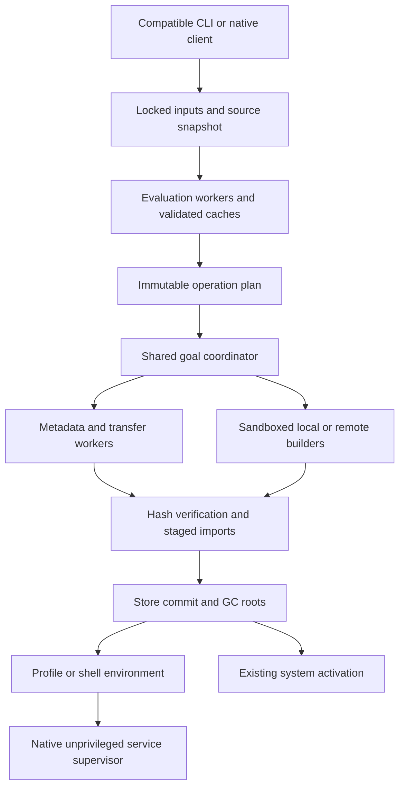

# Performance architecture and optimization plan

## Opt-in evaluator diagnostics, 2026-11-13

The evaluator's `eval-diagnostics` Cargo feature records executed opcodes and adjacent opcode pairs, frame scheduling and entry events, thunk construction and first/cached forcing, capture-length histograms, instrumented constructor allocation events and runtime layouts. It is absent from default builds. Build the command with `--features noxi-eval/eval-diagnostics` and set `NOXI_EVAL_DIAGNOSTICS` to a JSON output path. Snapshots accumulate on the evaluation thread across VM instances until `noxi_eval::perf_counters::reset()`; each completed evaluation atomically writes the cumulative snapshot. Separate threads and processes require separate output paths. The counters intentionally alter execution cost and must not be enabled in production timing comparisons.

Capture-buffer allocation counts are construction-site estimates. Instrumented thunk allocation payloads exclude reference-count headers and allocator overhead. These counters are not total allocator traffic or live-heap measurements. Derived capture clones and allocations outside the instrumented constructors are not included.

The independent command feature `eval-allocation-diagnostics` wraps the same production mimalloc allocator with allocation-free atomic accounting. Set `NOXI_EVAL_ALLOCATION_DIAGNOSTICS` to report successful/failed allocations and reallocations, requested allocation/deallocation bytes, and current/peak requested live bytes from process startup through CLI return, before report serialization. Requested bytes exclude allocator metadata, fragmentation, retained pages and temporary realloc copying storage. Concurrent background threads can make the snapshot fields nontransactional. Run this allocation-only build separately from opcode diagnostics and production timings.

The earlier 2026-11-13 work recorded its starting source and full dirty patch under `target/eval-20261113/{baseline,preservation}/`. New comparisons use a freshly built baseline with recorded source and executable hashes. The split EVAL-08 adapter retains the independently recorded path for each selected output; evaluating a single output is a different diagnostic workload from the four-output qualification and is reported separately.

The starting EVAL-08 diagnostic execution matched the four-path oracle and counted 245,306,061 logical opcodes, 70,584,198 bytecode frame entries and 36,679,134 thunk constructor allocations. Of 40,154,978 instrumented finalized capture arrays, 28,679,243 contain one or two static values. Instrumented capture-buffer payload totals are cumulative allocation estimates, not retained memory. These measurements motivate eliminating temporary suspensions before enlarging all capture representations with inline storage. A managed heap or VM-lifetime arena is not retained: cumulative traffic does not identify the retained graph, and returned values can outlive the VM that produced them.

Two production experiments are being compared independently. Boxing the rare error payload in `ContextMessage` reduces scheduler `Frame` size from 200 to 144 bytes while leaving `BytecodeFrame` at 128 bytes. The baseline workload never entered `ContextMessage`, so it adds no error-payload allocation on that execution. Three exploratory pairs do not establish a wall-time benefit for this change alone: paired speedup is 1.003x with interval [0.988, 1.012]. The immediate-force experiment targets 17,435,602 adjacent `ThunkSuspended`/`Force` executions. It enters the same bytecode and captured environment with a force continuation but no memoization cell for the unshared temporary. Deferred recursive captures and runtime observers keep the original path; a result that is another thunk reconstitutes the evaluated wrapper and uses the existing forcing path. Both experiments remain subject to final compatibility and representative performance checks.

User-only DWARF sampling requires `--user-callchains` in addition to `cycles:u` on this host. Omitting it requests disallowed kernel callchains. The resulting baseline profile matched the oracle, but 623 of 625 sampled memory-copy stacks still lacked a caller. Two resolved samples lead to frame-vector movement; they do not establish that all copies have that cause. LBR branch-stack sampling is unsupported by the available PMU. Exact profiler commands, errors and reports remain under `target/eval-20261113/`.

The first ten-block final lane was interrupted after memory pressure exceeded its declared host-validity threshold. Its completed and partial samples remain under `target/eval-20261113/final-eval08-10/` with `INVALID-HOST.json` and are excluded from performance qualification. An ancestor agent slice applies `memory.high` even though the leaf cgroup is uncapped. Inspecting only the leaf misses this limit. Clean pages from owned build artifacts can be advised out without modifying files or global host settings; final comparisons require a fresh quiet lane, with ancestor pressure and limits recorded, rather than selecting fast pairs from the interrupted run.

Status: evaluator hotspot measurements updated 2026-11-12; representative qualification measurements below remain separately dated; the current-main diagnosis and the evaluator cost reductions below are exploratory five-pair runs. The [runner](../benchmarks/README.md) supports 39 subsets of the 154 catalog scenarios. O06 bounds immutable source capture with an 8 MiB spool threshold; O09 indexes dependency edges while retaining serial realization and ready ordering. EVAL-08 now covers the qualification NixOS and Home Manager derivation paths. The remaining hypotheses and unimplemented parts of those hypotheses remain proposed work. The [benchmark specification](performance-benchmarks.md), [scenario catalog](../benchmarks/catalog.tsv), and [CppNix research](performance-research.md) define the evidence required before advertising an optimization.

## Evaluator attribute and context costs, 2026-11-12

Attribute updates now carry binding positions alongside the sorted merge, preserving the right operand's position even when it is absent. Chained merges retain these positions by offset; literal layouts provide source spans through their validated sorted permutation. This avoids constructing a new position hash map and looking up each merged key in both operands. Attribute sets without shared literal layouts use binary search for their first four lookups and build a hash index only when further lookups need it. Shared literal indexes retain their immediate initialization. Successful `addErrorContext` boundaries no longer traverse and format the outer trace stack; the suspended outer frames are counted when an error actually needs a context message.

The diagnostic [hotspot wrapper](../benchmarks/eval-hotspots.py) reuses the ordinary runner's independent expected JSON, reference comparison, shuffled matched blocks, isolated homes, dummy stores, process-tree accounting and bootstrap intervals. `EVAL-HOT-MERGE` performs 4,000 updates of a 256-binding literal with two subsequent selections and returns `9018000`. `EVAL-HOT-CONTEXT` returns `42` through 1,000 successful nested contexts. These cases are synthetic diagnostics outside the qualification catalog. CLI startup is included.

The preserved candidate is `target/agent-perf/c3/bin/nix-instantiate`, built with `CARGO_BUILD_JOBS=4 CARGO_TARGET_DIR=target/agent-perf cargo build --profile release-with-debug -p noxi-commands --bin nix-instantiate`. This profile inherits portable release optimization, fat LTO and one codegen unit, and retains debug information. The preserved base and intermediate artifacts under `target/agent-perf/{base,c2}/bin` came from this work session; their exact source snapshots were not recorded, so their comparisons are diagnostic rather than fully qualified ablations. The runner records executable hashes. The candidate's source record is adjacent to its binary directory.

Both runs use 30 matched blocks, seed 1729, and affinity `0-3,12-15` on the Ryzen AI 9 HX 370. All 120 merge and 90 context timed invocations passed their output oracles, as did their preflights. OS page cache, frequency and other host activity were uncontrolled. The merge timings below use a fresh run after profiling completed; these shared-host measurements are evidence for these specific diagnostic workloads, not a general evaluator qualification. Medians are shown below; speedups are paired geometric means with 95% bootstrap intervals.

| Workload / engine | Wall ms | CPU ms | Peak RSS MiB | Candidate speedup over engine |
| --- | ---: | ---: | ---: | --- |
| Merge / preserved base | 46.838 | 46.290 | 98.61 | 2.090x [2.000, 2.185] |
| Merge / before deferred indexes | 27.799 | 27.120 | 71.21 | 1.212x [1.190, 1.237] |
| Merge / CppNix 2.35.2 | 28.372 | 28.274 | 80.41 | 1.241x [1.197, 1.293] |
| Merge / candidate | 22.783 | 22.599 | 58.17 | n/a |
| Context / preserved base | 41.032 | 40.049 | 23.01 | 12.208x [11.434, 12.917] |
| Context / CppNix 2.35.2 | 15.762 | 16.053 | 49.20 | 4.793x [4.498, 5.068] |
| Context / candidate | 3.266 | 3.327 | 21.27 | n/a |

The fixed four-path EVAL-08 workload also passed all 15 timed invocations and three preflights in `target/agent-perf/final-eval08/`. This exploratory five-pair run does not establish a representative improvement: the candidate median is 19.518 s versus 21.684 s for the preserved base, but its 26.691 s and 49.503 s outliers produce a paired geometric speedup of 0.860x [0.577, 1.156]. CppNix's median is 3.789 s, leaving the candidate 5.15 times slower by median elapsed time. Median CPU times are 18.592 s candidate, 19.966 s base and 4.345 s CppNix; median peak RSS is 2,958.33 MiB, 3,059.07 MiB and 996.00 MiB respectively. Shared-host variation and the limited sample count prevent a general speed claim. Beating CppNix on representative NixOS/Home Manager evaluation remains open.

Raw records, environments, executable identities and output digests are in `target/agent-perf/final-{merge-clean,context,eval08}/`. Reproduce after preserving the desired artifacts:

```sh
devenv shell -- taskset -c 0-3,12-15 uv run --no-project --no-config python benchmarks/eval-hotspots.py --reference-bin target/nix-reference/bin --candidate-bin target/agent-perf/c3/bin --baseline-bin target/agent-perf/base/bin --comparison-bin before-index=target/agent-perf/c2/bin --case EVAL-HOT-MERGE --samples 30 --size 4000 --output target/agent-perf/reproduce-merge
devenv shell -- taskset -c 0-3,12-15 uv run --no-project --no-config python benchmarks/eval-hotspots.py --reference-bin target/nix-reference/bin --candidate-bin target/agent-perf/c3/bin --baseline-bin target/agent-perf/base/bin --case EVAL-HOT-CONTEXT --samples 30 --size 1000 --output target/agent-perf/reproduce-context
devenv shell -- taskset -c 0-3,12-15 uv run --no-project --no-config python benchmarks/run.py --reference-bin target/nix-reference/bin --candidate-bin target/agent-perf/c3/bin --baseline-bin target/agent-perf/base/bin --case EVAL-08 --samples 5 --timeout 300 --output target/agent-perf/reproduce-eval08
```

Flat `cycles:u` profiles identified the removed work. In the preserved base's merge profile, position-map insertion accounted for 13.33%, position-map lookup for 6.92%, and lookup-index initialization for 10.30% of samples. After position changes, index initialization grew to 20.39% of a smaller total, motivating deferred indexes. In the final profile it no longer appears among the leading entries; cloning the binding slice accounts for 24.62%, and collecting binding positions for 11.65%. In the base's successful-context profile, trace construction alone accounts for 16.60%, with another 14.29% in codemap span lookup and 6.88% in formatting. These short profiles support the mechanism; they do not replace matched timings. Reports and raw profiles are under `target/agent-perf/{base,c2,final}-merge*` and `target/agent-perf/base-context*`.

A separate candidate EVAL-08 profile, collected after timing with the same affinity and a fresh isolated environment, matched all four paths and recorded 8,228 samples with zero loss. Its largest entries are bytecode execution at 15.47%, libc memory movement at 8.13%, lambda execution at 7.37%, capture population at 4.33%, and value cloning at 3.45%. Attribute lookup is 1.06%. The remaining representative gap therefore needs broader VM and value-management work. Raw data and the report are `target/agent-perf/final-eval08.data` and `target/agent-perf/final-eval08-profile.txt`.

Correctness validation passes 533 evaluator tests plus one doctest with `devenv shell -- env CARGO_BUILD_JOBS=4 cargo test -p noxi-eval --quiet`. Added tests cover span provenance across balanced and skewed updates, KV operands, absent right-side positions, repeated updates, literal source-order permutations, and lookups before and after index creation. Direct comparisons against the pinned reference also match exit status, stdout and stderr for lazy successful contexts, nested abort contexts under `--show-trace`, and caught throws.

## Evaluator success-path diagnostics round, 2026-11-13

This round removes diagnostic work that ran on successful evaluation and keeps the two experiments recorded above. All measurements use the four-path EVAL-08 expression (`benchmarks/eval-08.nix`) under the runner's isolated environment (dummy store, empty `NIX_PATH`, fresh home), affinity `0-3,12-15` on the AMD Ryzen AI 9 HX 370, and `release-with-debug` builds (portable release, fat LTO, one codegen unit, debug information) from `HEAD` `67d460f` plus the uncommitted working tree. Every run's strict JSON output had digest `31328840df22d3ff`, byte-identical to pinned CppNix 2.35.2's output for the same command.

Changes are cumulative. Instruction counts are single `perf stat -e instructions:u` runs, which stay stable while wall time varies with host load. Other agents edited command and store crates between builds; the eval crate dominates this workload, but the last step's count includes their concurrent edits.

| Artifact | Change | EVAL-08 user instructions | Step |
| --- | --- | ---: | ---: |
| `target/agent-perf/base` | starting tree | 190.28 billion | baseline |
| `c1` | Count the outer traces of an `addErrorContext` boundary only when a context message is needed, not on every successful boundary | 173.08 billion | -9.0% |
| `c3` | `//` carries binding positions by offset instead of building a position hash map; deferred lookup indexes (see 2026-11-12 section) | 165.29 billion | -4.5% |
| `c4` | Box the cold `ContextMessage` error (scheduler `Frame` 200 to 144 bytes); enter a thunk constructed for an immediate `Force` directly without a memoization cell | 154.22 billion | -6.7% |
| `c5` | Share compiled regexes through `Rc` instead of cloning them, since a cloned `regex::Regex` starts with an empty match cache; cache each file's line starts for CppNix-style positions, which `derivationStrict` requests for every derivation's `name` | 146.76 billion | -4.8% |

The cumulative instruction reduction is 22.9%. A pinned CppNix invocation used about 41 billion instructions in earlier measurements, so noxi still executes about 3.6 times as many.

Ten shuffled matched blocks then compared CppNix, the starting tree and `c5` (seed 1729; 30 invocations, all matching). Memory pressure (`some avg10`) stayed between 1.4% and 4.2% during the run; compilation by other agents was not running but host activity was otherwise uncontrolled. Medians:

| Engine | Wall s | User CPU s | Peak RSS MiB |
| --- | ---: | ---: | ---: |
| CppNix 2.35.2 | 3.195 | 3.845 | 968.8 |
| Starting tree | 18.475 | 16.925 | 3,062.1 |
| `c5` | 15.200 | 13.765 | 2,953.2 |

`c5` is 1.226 times as fast as the starting tree (paired geometric mean, 95% bootstrap interval [1.212, 1.247]) and uses 3.6% less peak RSS. It remains 4.76 times slower than CppNix ([4.71, 4.81]) and uses 3.05 times its RSS. Ten blocks are fewer than the runner's 30-pair qualification default; the interval is narrow, but this is a diagnostic lane rather than a general speed claim. The near-reference gate remains open.

Validation at `c5`: 544 evaluator unit tests and the doctest (also with `eval-diagnostics`, adding five counter tests), the language runner with `NOXI_REFERENCE_BIN` (466 of 467 fixtures pass, one disabled, 466 exact live reference matches, all outcomes match the expectations file), and `just nixos-paths` all pass. `c4` passed the same suites before the last step.

Profiling method: the host rejects kernel callchains, so stacks came from a gdb-driven sampler (periodic `SIGUSR1` interrupts with `thread apply all bt`) and breakpoint backtraces on hot symbols. These samples are biased toward page-fault and syscall boundaries and were used only for attribution; flat `cycles:u` profiles and instruction counts decided changes. Before the first change, 7.4% of sampled stacks were trace construction under `addErrorContext`, all from one call site.

Remaining success-path diagnostic costs and candidates, not changed in this round:

- `builtins.genericClosure` prints every element with `ValuePrinter`, and both compared elements at every binary-search step, before it can know whether an error occurs (about 1% of cycles in `ValuePrinter` and string literal printing). CppNix prints in its `catch` handlers, after forcing. Deferring the print needs a lazily rendered trace entry and changes noxi's output in error cases toward CppNix's, so it needs its own fixtures.
- ATerm escaping in `nix-compat` runs an Aho-Corasick search per derivation string while hashing (about 1.1% of cycles). A scan for bytes needing escaping before the search is a candidate outside this crate's ownership.
- The flat profile is now led by bytecode dispatch (about 16%), the frame loop (7%), memory copying (6%), capture population (5%) and value cloning (5%). These need representation changes, such as smaller frames, compact captures and fewer generator frames, rather than more success-path fixes.

Artifacts: binaries in `target/agent-perf/{base,c1,c3,c4,c5}/bin`, test logs `target/agent-perf/nixos-paths-c{4,5}.log`, and the language runner reports under `target/agent-perf/tmp/`.

## Qualification evaluator measurements, 2026-10-25

EVAL-08 evaluates the exact four derivation paths from `just nixos-paths`: the qualification NixOS system, its VM, its Home Manager module generation, and a standalone Home Manager generation. Nixpkgs is locked at `e94cb152ed51bd6e24eb4a41f1460252beb52cd2` and Home Manager at `7b4c5ec4bedaf1e062bbc1bcaeddbc6bd242aa1b`. Every engine must independently match all four recorded paths as strict JSON and then match the pinned reference. Host Nix resolves the source paths outside timing; each timed engine evaluates the modules itself against a read-only dummy store.

The final run, `target/benchmarks/eval-hotpaths-final-30`, contains 30 shuffled matched blocks with five release artifacts, plus one preflight per artifact. All 155 invocations passed. Builds used the normal portable release profile through `devenv shell -- just bench-build`. All engines inherited affinity `0-3,12-15` on an AMD Ryzen AI 9 HX 370, four physical faster cores with their SMT siblings. This is a fixed-resource lane: those cores advertise 5.16 GHz versus 3.29 GHz for the other cores. The governor remained `powersave`; OS page cache and other host activity were uncontrolled. These are fresh CLI processes and isolated application state.

Wall and process-tree CPU times are medians. RSS and cgroup memory columns are medians of each invocation's peak. Cgroup memory includes charged page cache and is distinct from target process RSS. Step speedups are paired geometric means with 2,000-resample bootstrap intervals; the final column is the ratio of wall-time medians.

| Engine / cumulative change | Wall s | CPU s | Peak RSS MiB | Cgroup peak MiB | Speedup over preceding noxi, 95% CI | Wall / CppNix |
| --- | ---: | ---: | ---: | ---: | --- | ---: |
| CppNix 2.35.2 | 3.186 | 4.143 | 979.4 | 967.0 | n/a | 1.000x |
| Original noxi, `569e1b3` | 22.927 | 22.839 | 4,694.8 | 4,697.7 | baseline | 7.197x |
| Direct captures, `04469d5` | 21.737 | 21.656 | 4,612.4 | 4,615.4 | 1.053x [1.044, 1.060] | 6.824x |
| Memoized forcing, `2fe6949` | 20.450 | 20.377 | 4,612.7 | 4,615.3 | 1.065x [1.058, 1.075] | 6.419x |
| Shared mapped-call bytecode, `772d833` + `a77b06f` | 19.526 | 19.419 | 3,240.5 | 3,241.0 | 1.047x [1.041, 1.054] | 6.129x |

The cumulative paired speedup is 1.175x, 95% interval [1.170, 1.180]. The wall-time medians differ by 3.401 s, a 14.8% reduction. Median peak RSS fell by 31.0%; the largest observed target RSS was 4,695.1 MiB for the original and 3,241.2 MiB for the final candidate. Evaluation still takes 6.1 times the reference's median elapsed time, so TODO section 3's near-reference gate remains open. These measurements qualify this four-path workload in this resource lane.

The changes address costs identified by flat `cycles:u` profiling:

- Directly install populated captures when constructing VM thunks and closures, reserve the known capture count, and remove redundant reference-count operations. This avoids allocating a capture vector only to replace it immediately.
- Read fully memoized thunk values directly in bytecode and builtin force/try-force requests. Suspended thunks, blackholes, and evaluated thunks pointing to another thunk retain the normal forcing path.
- Share one generated application lambda per invocation of `map`, `mapAttrs`, `genList`, and `zipAttrsWith`. Each resulting thunk keeps its own argument and callee captures. Empty results return before allocating application bytecode. The ordinary suspended-thunk machinery, source spans, and error types remain unchanged.

After timing, fresh controlled profiles of the preserved original and final artifacts used the same isolated environment and affinity. `perf record -e cycles:u -c 10000000` collected 10,756 and 9,211 samples respectively, with zero lost samples; both profiling invocations also matched the four-path oracle. The visible libc allocation/free/reallocation routines account for approximately 22% of original samples and 19% of final samples. In the final profile, bytecode dispatch accounts for 9.71%, generator dispatch for 8.20%, and thunk forcing for 5.11%. These fractions describe a smaller total cycle count, approximately 107.56 billion original versus 92.11 billion final, and do not replace the 30-block timing estimate. Further evaluation-time work needs to address the remaining VM/generator and value-management costs. Raw data, flat reports and exact commands/environments are in `target/benchmarks/profiles/controlled-{original,candidate}.{data,txt,json}`; `target/benchmarks/profile-eval.py` reproduces them. The host rejected frequency sampling and call-stack capture, so these are fixed-period, user-space flat profiles.

The reference-generated `eval-okay-shared-mapped-call-captures` fixture checks empty-result laziness and independent captured values for all four builtins. Full CI passed 2,726 nextest tests with five skipped and all doctests; all twelve benchmark-runner tests passed. Both `just nixos-paths` and `just nixpkgs-paths` passed unchanged after every optimization stage.

The original release and each intermediate artifact, source identities, exact arguments and isolated environments, fixture digest, CPU/I/O counters, target RSS, cgroup memory, stdout/stderr, and manifest are retained under `target/benchmarks/`. The final manifest's 470 files and every measured binary digest were verified. `eval-hotpaths-final-30-adjacent-summary.json` and `analyze-eval.py` retain the adjacent-stage analysis outside the sealed run directory. Preliminary `eval-baseline`, `eval-captures`, and `eval-forced` runs were exploratory; the partial `eval-hotpaths-30` and `eval-hotpaths-bigcores-30` matrices were stopped to control affinity and remove empty-result allocation respectively. Their samples are not pooled with the final run.

Reproduce the final matrix after preserving artifacts as described in the benchmark README:

```sh
devenv shell -- taskset -c 0-3,12-15 just bench target/nix-reference/bin target/benchmarks/eval-final/bin target/test-busybox --baseline-bin target/benchmarks/eval-forced-baseline/bin --comparison-bin original=target/benchmarks/eval-original/bin --comparison-bin captures=target/benchmarks/eval-captures-baseline/bin --case EVAL-08 --samples 30 --timeout 300 --output target/benchmarks/eval-hotpaths-repeat
```

## Second evaluator round, 2026-10-26

The preserved round-one release in `target/benchmarks/eval-final/bin` is the baseline for this round (19.526 s median wall time and 3,240.5 MiB median peak target RSS in the preceding controlled run). Builtin values now share immutable metadata with copy-on-write partial arguments; completing an application copies only captured arguments when necessary. The `eval-okay-shared-builtin-partials` reference fixture checks independent reuse of those captures. Non-async builtin bodies also register a synchronous entry point: fourteen type predicates, list operations and attribute lookups can bypass generator construction when all strict arguments are ready. Suspended arguments retain the existing generator and forcing order; lazy arguments remain untouched. Macro tests cover both paths, catchable propagation and captured state. No error types changed.

The exploratory runs `round2-shared-5` and `round2-shared-3` were interrupted because concurrent worktree builds caused substantial host memory pressure and swapping. Their completed invocations matched the independent path oracle, but their timings are not used to claim an improvement. New performance claims require a fresh fixed-affinity matched comparison.

The bytecode dispatcher now continues directly after a partial builtin application or successful synchronous call, avoiding a frame push/pop, another outer dispatch and a source-span lookup. Suspending calls and errors retain the caller frame and its original span. A release differential check covers 46 success, error, catchable, partial-application and control-flow expressions, preserving exit status, stdout and full trace stderr against the preceding artifact.

## Current merged evaluator diagnosis, 2026-10-26

A fresh portable release of main `a7548847` was compared with the preserved round-one release and pinned CppNix 2.35.2 on EVAL-08. The same fixed affinity `0-3,12-15`, locked inputs, read-only dummy store and independent four-path JSON oracle were used. The host passed a 20-second quiet-window check before collection; maximum full memory PSI remained 0.00% throughout. No compilation overlapped the timed run. Application state was isolated, but OS page cache and unrelated host activity were not controlled. These five shuffled matched blocks are diagnostic evidence, not a replacement for the earlier 30-block qualification or a general package-management score. All fifteen timed invocations and three preflights matched the oracle.

| Engine | Median wall s | Median process-tree CPU s | Median peak target RSS MiB |
| --- | ---: | ---: | ---: |
| CppNix 2.35.2 | 3.267 | 4.226 | 966.4 |
| Preserved round-one noxi | 20.064 | 19.952 | 3,240.2 |
| Current main, `a7548847` | 22.878 | 22.776 | 3,324.0 |

Current main takes 7.00 times the reference's elapsed time and 3.44 times its peak RSS in this small run. It also takes 14.0% longer than the preserved noxi release and uses 2.6% more peak RSS. Current-main wall times span 22.558-23.332 s; reference times span 3.227-3.272 s. The earlier 19.526 s result does not describe the newly merged tree. Median physical disk reads and writes were zero for both engines, and noxi's CPU time is nearly equal to elapsed time: the measured delay is evaluation work, rather than downloads, building or an idle process waiting on those services.

Fixed-period user-space `cycles:u` profiles were collected separately from timing for all three artifacts. Call stacks were unavailable under the host's `perf_event_paranoid=2` policy, so these are flat, exclusive symbol samples, not inclusive call-tree costs. The current, preceding and reference profiles contain approximately 109.84, 95.36 and 19.12 billion sampled-event cycles respectively, with zero lost samples. Function boundaries and inlining differ between artifacts; percentages alone cannot isolate the causal effect of an individual commit.

The current profile assigns 18.99% to libc allocation/free symbols, 10.28% to bytecode dispatch symbols, 7.60% to generator driving/resumption, 3.81% to bytecode operand decoding, 3.97% to thunk forcing, 2.59% to capture population, 3.39% to value-cloning symbols and 2.39% to libc memory copying. Generator re-enqueueing adds 2.55%. These paths support the primary diagnosis: the evaluator performs substantial scheduling, ownership and data-management work per lazy language operation. Parser/compiler symbol groups account for 5.04% of this flat profile, so parser replacement is a lower-priority hypothesis for this workload.

The source explains the mechanisms. `vm/generators.rs` represents resumable work as `Gen<VMRequest, VMResponse, Pin<Box<dyn Future<...>>>>`; forcing an unready value can re-enqueue one frame, allocate another generator and return through the outer VM loop. `Thunk` uses `Rc<RefCell<ThunkRepr>>` and a separate `Rc<Upvalues>` containing vectors of captured values. Shared attribute-set updates can clone their backing maps. The pinned CppNix source instead forces a thunk through its expression and environment pointers, batches value allocation in `EvalMemory::allocValue`, and uses compact interned symbols and attribute bindings. This is an implementation and representation gap; these profiles do not establish an inherent Rust-versus-C++ cost or prove that a VM is necessarily slower than an AST evaluator.

The memory policies also differ. The default noxi command enables `impure`, not the evaluator's optional `no_leak` feature. Its context-free `NixString` allocations are deliberately not freed, allowing pointer-copy clones; `Rc` alone cannot collect reference cycles in the lazy value graph. Enabling `no_leak` is not an established fix: it changes string cloning/deallocation costs and requires its own matched measurement. A separate CppNix `NIX_SHOW_STATS` invocation, excluded from timing, reports 19,360,824 values, 9,713,630 environments and 3,026,115 attribute sets containing 23,899,850 attributes. Its value and attribute entries are each 16 bytes. Four GC cycles manage about 1,073.4 MiB of total GC allocations, leaving a 720.3 MiB GC heap after the final collection. This illustrates how per-object overhead and reclamation matter at this scale; there is no allocation-stack or retained-heap breakdown yet assigning noxi's extra memory to specific object classes.

Recent diagnostics add measurable work on successful evaluation too. `FrameTrace` cloning and dropping account for 3.20% of current samples, and source-span lookup for 2.59%; the frame loop clones trace metadata at each transition, generator suspension clones it again, and function calls retain parent frames for accurate traces. The old artifact has no `FrameTrace` clone/drop symbols. These are credible contributors to the observed regression, but this comparison includes many other semantic changes and compiler/inlining differences. It does not attribute the full 14.0% slowdown to diagnostics. Trace rendering remains necessary for compatibility; the experiment to prioritize is a cheaper representation and deferred materialization that preserves the same errors and call sites.

The next experiments should measure compact frame/continuation state and additional synchronous forcing paths, allocation count and retained bytes by object class, and trace bookkeeping separated from error materialization. Attribute-map sharing and compact capture storage are candidates after that attribution. Swapping an allocator or removing the measured libc allocation/free time alone cannot close this gap: eliminating that 18.99% symbol bucket entirely would yield only about 1.23 times the speed. New optimizations still require per-change comparison with both preserved noxi and pinned CppNix, exact diagnostics, and unchanged `just nixos-paths` and `just nixpkgs-paths` results.

Raw diagnostic artifacts are in `target/performance-diagnosis-2026-10-26/`: `matched-5/` contains samples, manifests, environments, correctness results and hardware; `main/` preserves the executable and source identity; `host-state.jsonl` records the quiet-window/pressure checks; `profiles/` contains the three perf captures, symbol reports, summarized groups and reference allocation statistics. `diagnostic-summary.json` records the measured medians. No evaluator implementation was changed for this diagnosis. A recovery copy of these artifacts is preserved at `/home/rajveer/.local/state/noxi-performance-diagnosis/2026-10-26-a7548847`.

## Evaluator cost reductions, 2026-10-27

The changes below address the mechanisms the diagnosis named. Each is its own commit, checked against its predecessor by user-space instruction counts (`perf stat -e instructions:u`), which stayed stable while wall time varied with unrelated host load. Every candidate also ran a differential against the merged-main artifact. That differential covers 362 language fixtures and 34 extra expressions (errors, catchable errors, `tryEval`, assertions, infinite recursion, `with`, selection and deep-force traces), each with and without `--show-trace`, and compares exit status, stdout and stderr. All outputs were identical for every kept change. The workspace tests, doctests, `just nixos-paths` and `just nixpkgs-paths` pass at the final revision.

| Change | EVAL-08 effect |
| --- | --- |
| Move a generator's trace into the running frame instead of cloning it per transition; skip the clone for trace-less bytecode frames | with the next change, 5.4% fewer instructions |
| Record each suspended thunk's span at compile time instead of a binary search per thunk | included above |
| Force a plain suspended bytecode thunk by entering its code directly under a `Force` frame, which stands in for the `force` generator one for one: same frame indices, spans, error chains, traces and blackhole | 17.9% fewer instructions |
| Allocate with mimalloc in `noxi` and the `noxi-commands` executables | 8.2% fewer instructions, 5% lower peak RSS |
| Box lambda formals and release chunk spare capacity; a lambda allocation drops from 320 to 240 bytes | peak live heap about 140 MiB lower |
| Store static upvalues as a boxed slice and share captured `with` stacks; `Rc<Upvalues>` drops from 64 to 48 bytes | peak live heap about 130 MiB lower |
| Fat LTO with one codegen unit for release builds | 4.7% fewer instructions |
| Test for a catchable error inline before tracing a result | 0.6% fewer instructions |
| Share the attribute-position map of sets built from one literal when their positions match, and stop deep-copying it with the set | about 110 MiB lower peak RSS, 1% fewer instructions |

Together the user-space instruction count fell from 231.4 to 158.2 billion. Rebuilding the merged-main baseline and the pre-mimalloc revision with the newer nightly gave the same instruction counts, so the toolchain update in the same period does not account for these differences.

A five-pair matched run with the repository runner then compared the final revision `1018a06d` with the preserved round-one release and pinned CppNix 2.35.2, using the same affinity, inputs, dummy store and oracle as the diagnosis. The host was not quiet; the CPU times below are less affected by that than wall times. All fifteen timed invocations matched the oracle.

| Engine | Median wall s | Median process-tree CPU s | Median peak target RSS MiB |
| --- | ---: | ---: | ---: |
| CppNix 2.35.2 | 3.318 | 5.117 | 994.1 |
| Preserved round-one noxi | 20.246 | 20.082 | 3,240.5 |
| Final revision, `1018a06d` | 15.170 | 15.088 | 2,937.3 |

The final revision is 1.35 times as fast as round one (95% interval 1.31-1.39), which reverses the merged tree's 14% regression, and uses 9% less peak RSS. It still takes 4.57 times CppNix's elapsed time and 2.95 times its peak RSS.

Three experiments were rejected. The `no_leak` feature raised peak RSS to 3.98 GB because it also disables string interning, and it ran more instructions, so leaked context-free strings are not the memory problem. Sharing captured `with` stacks alone gained under 1%; it was kept only as part of the compact upvalue representation. A synchronous fast path for `==` between evaluated scalars saved 1.2% of instructions, below the 2% bar for this round.

The remaining gap is architectural. Builtins, comparisons, equality and string coercion still run as boxed generators. A thunk cell takes 56 bytes, and about 9 million are live at peak, against CppNix's 16-byte values. `//` copies its maps, as CppNix also does. `Rc` cannot collect reference cycles without a collector. A live-size histogram at peak attributes about 480 MiB to thunk cells, 330 MiB to upvalues, 230 MiB to lambdas and 590 MiB to allocations of a kilobyte or more, which include source text and attribute tables. These need representation changes, not further local fixes.

Raw artifacts are in `target/performance-tip-2026-10-27/`: `bin/` holds the measured executables, `matched-5/` the runner samples and report, `summary.txt` the medians, and `differential/` the differential and instruction-count scripts. A recovery copy is at `/home/rajveer/.local/state/noxi-performance-tip/2026-10-27-1018a06d`.

## Evaluator CPU workstream, 2026-10-27

The `perf/eval-cpu` baseline reproduces EVAL-08 at 158.416 billion user-space instructions and 2,970,506 KiB median peak RSS across two invocations. Fixed-period `perf record -e cycles:u -c 10000000` collected 7,162 samples with none lost. The flat profile assigns 14.48% to bytecode dispatch, 5.47% to generator driving, 2.01% to operand decoding and 1.28% to dropping frame traces. Temporary builtin counters identify `map` and `mapAttrs` as the most frequent full builtin calls, at 421,627 and 398,652 respectively. Counter instrumentation is excluded from the measured binaries.

Thirty more builtin bodies now register synchronous entry points, including `map`, `mapAttrs` and `genList`, whose generated thunks retain the original call span. An explicit VM continuation forces their strict arguments from left to right before calling the body. Catchable arguments retain the generated wrapper's propagation and `#[catch]` behavior. The combined change uses 155.148 billion instructions, a 2.06% reduction, with 2,986,918 KiB median peak RSS. Both invocations retain the required `f4e14079455b2d17` output digest. The 518 evaluator and builtin-macro tests, doctests and the full baseline differential pass, including exit status, stdout and full trace stderr.

Evaluated scalar equality and comparison, numeric/string addition, path/string concatenation and scalar string coercion now run directly without generator frames. Equality and comparison also avoid allocating their work vectors for scalar arguments inside builtin calls. Suspended values, aggregate comparisons, imports and failures retain the original generator paths. This step uses 149.092 billion instructions, 3.90% below the synchronous-builtin revision and 5.89% below the original baseline, with 2,935,974 KiB median peak RSS. Both EVAL-08 digests, all 518 tests, doctests and the full baseline differential pass.

Bytecode frames now lend their trace to error construction instead of cloning it on entry. Attribute-name span lookup is deferred until a type error, and single-byte vu128 operands bypass the general decoder. This step uses 141.545 billion instructions, another 5.06% reduction and 10.65% below baseline, with 2,947,432 KiB median peak RSS. Both digests, the 518 tests, doctests and the full differential pass. A separate CppNix invocation uses 41.005 billion instructions and 1,002,056 KiB peak RSS, so the instruction gap is still 3.45 times at this stage.

Five-pair instruction profiles of START-03 and EVAL-01 through EVAL-06 pass all reference oracles for the baseline and first two revisions. At size 64, the synchronous revision's small-case instruction changes range from a 0.10% reduction to a 0.24% increase. The evaluated-operation revision reduces EVAL-04 and EVAL-06 by about 1.8%; its largest small-case increase is 0.17%. These startup-scale changes are recorded rather than rounded into a blanket no-regression claim.

The ready-argument expansion alone saved only 0.3%; adding the forcing continuation without the span-aware mapped builtins saved 1.5%. Neither intermediate qualifies as a standalone improvement. These shared-host runs gate instruction counts and RSS; their wall times do not establish a speedup. Artifacts, flat reports and preserved executables are under `target/perf-cpu/` in the CPU worktree.

### Pinned fixture recheck, 2026-10-28

The shared orchestration scripts now read immutable fixture copies under `target/perf-orchestration/fixtures`. Two more invocations of the committed bytecode-frame revision use 141.454 billion median instructions and 2,933,192 KiB median peak RSS. A fresh baseline invocation uses 158.459 billion instructions and 2,967,524 KiB RSS; CppNix uses 41.010 billion instructions and 1,012,516 KiB RSS. All four evaluations retain `f4e14079455b2d17`. The prescribed `tip-bin` reference and the preserved baseline executable have identical SHA-256 hashes, and their pinned-fixture differential outputs match byte-for-byte. An earlier invocation against a temporarily renamed qualification hostname is excluded from these comparisons.

An experiment consuming list and attribute operands instead of cloning their `Rc` owners uses 139.591 billion median instructions, only 1.32% below the committed revision, and 2,944,516 KiB median peak RSS. It fails the 2% instruction gate without a memory improvement and has been removed. Its patch and executable remain in `target/perf-cpu/` for inspection.

The final small-case matrix contains five samples for each of six executables on START-03 and EVAL-01 through EVAL-06 at size 64. All 252 preflight and sample oracles pass. Relative to baseline, the committed revision reduces median instructions by 3.17% on EVAL-04 and 2.50% on EVAL-06; its largest increase is 0.074% on EVAL-01. The ownership experiment changes these small cases by less than 0.09% relative to the committed revision. These instruction profiles include the original commands in `final-small/samples.jsonl`; their wrapper-inclusive wall times are not speedup evidence.
## Evaluator memory representation, 2026-10-27

A fresh three-run EVAL-08 baseline at `3012fb5` used a median 158.445 billion user-space instructions and 2,985,744 KiB peak RSS. Every run produced digest `f4e14079455b2d17`. Measurements use the orchestration script's isolated dummy-store environment and the shared heavy-job lock; wall time is not a decision metric on this shared host.

A separate temporary counting allocator around mimalloc measured 2,664,149,140 bytes of peak requested live allocations. It snapshots live size bins whenever the high-water mark crosses another 4 MiB. The last snapshot was 2,663,383,131 bytes: the 56-byte bin containing thunk cells held 9,140,997 allocations and 488.2 MiB; the 48-byte bin containing upvalue headers held 7,258,050 allocations and 332.2 MiB; the 248-byte bin containing lambdas held 1,007,698 allocations and 238.3 MiB. Reported bins of at least 1 KiB accounted for another 606.5 MiB. These are allocation-size bins, not allocation-stack attribution. Layout checks confirmed a 16-byte `Value`, 32-byte `ThunkRepr`, 32-byte `Upvalues`, and 232-byte `Lambda`, before reference-count headers and the thunk's borrow flag. The instrumented executable matched the output digest but is excluded from instruction and RSS comparisons. At command return, 2,629,335,153 requested bytes remained live, so retention also needs attention.

The compiler now constructs a function literal's closure directly in positions where it immediately forces the literal: a call's callee and a function's returned expression. Recursive closures retain the ordinary force operation and finalisation. Lazy positions keep the suspended wrapper, preserving unforced function previews. Three EVAL-08 runs reduced median instructions from 158.445 to 152.920 billion, a 3.5% saving. Median RSS was effectively unchanged at 2,983,400 KiB. All output/error/trace differential files matched the baseline byte-for-byte, all 519 evaluator tests and the doctest passed, and all 90 timed EVAL-01 through EVAL-06 samples matched their oracles. Smaller-workload instruction medians did not regress; EVAL-04 saved 6.7% at size 1,024. These are instruction and memory diagnostics, not a wall-time qualification.

A fresh three-run pinned CppNix comparison produced the same digest with median 41.011 billion instructions and 1,018,852 KiB peak RSS. After the compiler change noxi still uses 3.73 times the instructions and 2.93 times the RSS, so the memory target remains open.

One representation experiment was rejected. Moving suspension spans into shared bytecode and retaining that bytecode in blackholes reduced the thunk allocation request from 56 to 48 bytes. The full output/error/trace differential, 518 evaluator tests and the doctest passed, but median EVAL-08 instructions rose to 163.036 billion, 2.9% above baseline, while RSS barely changed at 2,973,444 KiB. The production thunk representation remains unchanged.

Unconditionally constructing function literals as closures was also rejected. It saved 5.2% of EVAL-08 instructions, from 158.445 to 150.253 billion, and reduced median RSS to 2,961,572 KiB, but changed unforced functions in error previews from `«thunk»` to a lambda with its name and position. Function construction can bypass a wrapper only where the compiler already forces that literal.

Raw counting-allocator source, its patch and executable, baseline measurements, rejected patches, test logs, and differential outputs are retained under `target/perf-memory/` in the `perf/eval-memory` worktree. The baseline differential is `target/diff-baseline/`.

## Evaluator capture ownership experiments, 2026-10-28

Suspended thunks now own their captures directly and move them into an owning VM frame on forcing. Function calls retain shared `Rc<Upvalues>` captures. This removes the separate capture-header allocation for suspended thunks without adding one when forcing them. In three EVAL-08 runs, median instructions fell from the compiler commit's 152.920 to 151.811 billion, and median RSS fell from 2,983,400 to 2,851,272 KiB: 0.7% fewer instructions and 129 MiB less RSS. Against the original `3012fb5` baseline, the branch saves 4.2% of instructions and 4.5% of RSS. All three runs produced digest `f4e14079455b2d17`; the full pinned-fixture differential was byte-identical, 520 evaluator tests and the doctest passed, and `just nixos-paths` and `just nixpkgs-paths` passed. All 90 timed EVAL-01 through EVAL-06 samples matched their oracles; smaller-case instruction changes versus the compiler commit span -1.94% to +0.06%. Artifacts are `target/perf-memory/owned-frame*`.

The measured branch tip still uses 3.70 times the pinned CppNix instruction count and 2.80 times its RSS. The 1 GiB memory target remains open; reclaiming unreachable value cycles is the next substantial opportunity. The earlier live-heap measurement found most requested bytes still allocated at command return, and reference counting alone cannot reclaim those cycles.

Storing captures inside suspended thunk cells and allocating `Rc<Upvalues>` only on forcing reduced median EVAL-08 RSS from 2,983,400 to 2,855,796 KiB, about 125 MiB. It raised instructions from 152.920 to 154.376 billion, however, and regressed EVAL-04 by 1.45% and EVAL-06 by 0.98%. This version was rejected despite passing the exact differential, 520 evaluator tests, the doctest and both path checks. Its patch, binary and measurements are under `target/perf-memory/inline-upvalues*`.

The baseline already avoids suspended wrappers for constants and known local references, and moves a forced thunk's captures into its executing frame. A regression test now checks that the thunk cell does not keep those captures alive after the frame releases them. Ordinary imports cache their compiled result, and imported ASTs are dropped after compilation; `scopedImport` deliberately compiles each scope separately. Evaluation results can contain values reused in later evaluations, so an arena freed when the VM returns would invalidate those values. An arena design needs owners that outlive the VM or a collector.

After the main checkout's rename, differential scripts read pinned fixture copies. The refreshed reference directory is `target/diff-pinned-baseline/`; earlier `target/diff-baseline/` results contain different absolute source paths. Both contain 2,376 exit/stdout/stderr files.

## Store substitution costs, 2026-10-27

The store workstream starts at `3012fb5`. Its release binaries, source identities, profiles and comparison runs are retained under `target/store-perf/` and `target/benchmarks/store-*` in the implementation worktree. These five-pair runs are exploratory measurements on a shared host. Instruction counts decide whether to retain a change; wall times describe these particular loopback fixtures.

The apparent fixed HTTP transfer cost was predominantly content-address verification. A `strace -f -tt -T` capture starts the first HTTP request about 19 ms after exec. The flat user-cycle profile assigns 58.1% to `Rewriter::drain`, 31.6% to its byte comparisons and 9.3% to SHA-256. The old rewriter searches for a store hash with a map lookup at every byte offset. Substring search for one pattern and Aho–Corasick for multiple equal-length patterns preserve leftmost nonoverlapping matches, absolute offsets and matches spanning writes. The test compares every chunk size against the original search rule.

On CACHE-01, the change reduces user instructions from 2,654,304,287 to 206,315,211, a 92.2% reduction. Peak RSS measured with `/run/current-system/sw/bin/time -f %M` changes from 14,340 to 14,252 KiB. The matched five-pair run reduces the preserved baseline's median from 615 ms to 226 ms; CppNix takes 158 ms. Correctness passes for CACHE-01, all six CACHE-08 formats, both CACHE-10 transports and NAR-05. The store/build tests and doctests pass, as do all 70 command tests, with two optional skips.

HTTP startup, certificate loading and an async runtime are not responsible for the dominant CPU cost in this fixture. A separate request cost remains: repeated narinfo responses incur roughly 41 ms waits between headers and body. Planning and realization issue three metadata requests for a single path, compared with one in CppNix. Decompression already streams into NAR restore; it does not buffer a complete downloaded NAR.

HTTP narinfo lookups now share positive and negative results between cache handles, with the configured TTLs; transport and parse errors remain retryable. Planning prefetches independent HTTP metadata within the substitution-job and HTTP-connection limits. File caches retain live metadata reads and skip prefetch. CACHE-02 narinfo requests fall from 96 to 32, and user instructions fall from 16,114,445 to 14,627,423, a 9.2% reduction. Its separate direct probes take 4.05 s before and 1.20 s after. Parallel workers raise peak RSS from 14,052 to 58,372 KiB; the matched CppNix run uses about 77 MiB. This is a concurrency cost, not a memory reduction over the previous serial implementation.

The HTTP connection limit follows CppNix's zero convention: `http-connections = 0` removes that limit, while `max-substitution-jobs` still bounds work and is clamped to at least one. The configuration test covers both direct settings and parsed configuration.

The `store-metadata` five-pair run passes all cache correctness checks. Candidate versus CppNix medians are 2,752 versus 4,435 ms for CACHE-03, 1,455 versus 2,747 ms for CACHE-06, and 1,170 versus 1,668 ms for CACHE-10/http. CACHE-10/file remains faster than CppNix, 15 versus 39 ms. CACHE-08 is near parity for none and XZ, and faster for the other four formats in this run. The host was busy, especially during CACHE-01 and CACHE-02; the retained instruction-count improvement is more reliable than their elapsed ratios.

An HTTP/1.0 correctness failure was reproduced independently: repeated fresh commands sometimes fetch narinfo but fail before requesting the NAR. The pinned ureq protocol code does not treat a length-delimited HTTP/1.0 response as implicitly closing the connection. After detecting such a response without explicit keep-alive, subsequent requests avoid the stale pooled connection and request explicit closure. HTTP/1.1 pooling remains enabled. Six fresh substitutions on each protocol pass, and the metadata test covers clone sharing, expiry, disabled caching and reading the NAR body on both protocols. All 70 command tests and 19 substitution/store-concurrency compatibility tests pass, with their optional skips.

NAR import now hashes the validated archive while restoring it, then reuses its SHA-256 and length for content addressing and registration. Other requested hash algorithms retain their separate digest pass. This removes two filesystem serialization/hash passes for SHA-256 archive imports without changing source capture or evaluator code. NAR-05 user instructions fall from 269,589,939 to 181,709,575, a 32.6% reduction; peak RSS changes from 39,152 to 38,696 KiB. The archive test checks SHA-256, SHA-512, symlinks and bytes following the archive. Store/build tests (23 passed, one optional skip), 20 compatibility tests, 70 command tests, doctests and both NixOS/Nixpkgs path checks pass.

An additional experiment processed incoming rewrite buffers directly instead of copying each chunk into the pending buffer. CACHE-01 instructions changed from 206,213,656 to 206,018,157, only 0.1%, with no clear memory benefit. It was rejected under the 2% instruction gate. The retained substring-search implementation still buffers chunks; its much larger search improvement is independent of this experiment.

### Immutable import captures, 2026-10-30

The local import path now carries the source capture's SHA-256 into registration instead of hashing the same snapshot again during restore. Capture owns its bytes privately and exposes no mutation after hashing. The NAR parser still validates the archive, and the digest is reused only when its consumed length matches the capture; trailing bytes use the restored tree's digest. Ordinary reader imports and remote imports retain their independent verification. The CLI's `LocalBackend` forwards the capture explicitly; the initial experiment omitted that forwarding and saved no instructions on the actual CLI, so it was corrected before retention.

The existing 8 MiB limit is a spill threshold. Small captures stay in memory; the 32 MiB NAR-05 fixture spills to a private temporary file. Source replacement after capture and rejection of a wrong expected hash retain their previous behavior.

The unlocked release probes reduce NAR-05 user instructions from 181,713,611 to 95,280,270, a 47.6% reduction on top of the restore-hash change. Peak RSS is essentially unchanged, 38,932 versus 38,720 KiB; the matched CppNix probe uses 128,180 KiB. In `target/benchmarks/store-capture-gate`, five paired samples give preserved-baseline, candidate and CppNix medians of 130.9, 82.3 and 108.0 ms, respectively, with a paired 1.31x ratio against CppNix. These shared-host timings are exploratory.

All 56 store/build/glue tests, 70 command tests, 20 store/substitution compatibility tests and affected doctests pass. One command test produced a harness leak warning during the full run and passed cleanly on its own. All 792 language differential evaluations match the preserved orchestrator tip. Six fresh 32 MiB substitutions on each of HTTP/1.0 and HTTP/1.1 pass at this release, each with one narinfo GET and one NAR GET. The HTTP/1.0 fix remains in the earlier cache-metadata commit; no TCP delayed-ACK changes are included here.

### Branch-tip comparison, 2026-10-30

The code at `70d32c3` passes all 36 selected benchmark variants in `target/benchmarks/store-branch-tip`. The preserved binaries and matching source identity are in `target/store-perf/tip-release`. Measurements run unlocked under the revised brief. These five-pair shared-host results are exploratory; the orchestrator's quiet-host run remains the wall-clock qualification. Times below are medians; the ratio is the paired geometric mean of CppNix time divided by candidate time, so it can differ from the ratio of the two medians.

| Case | Before ms | Tip ms | CppNix ms | CppNix / tip | 95% interval |
| --- | ---: | ---: | ---: | ---: | --- |
| CACHE-01 | 618.8 | 135.1 | 171.8 | 1.212x | 1.054 to 1.394 |
| CACHE-02 | 4082.4 | 220.4 | 1742.0 | 8.062x | 7.521 to 8.986 |
| CACHE-03 | 8455.9 | 4078.6 | 5655.6 | 1.280x | 0.734 to 1.905 |
| CACHE-06 | 4116.8 | 1478.9 | 2754.1 | 1.953x | 1.792 to 2.201 |
| CACHE-08/br | 761.0 | 140.4 | 164.8 | 1.090x | 0.958 to 1.243 |
| CACHE-08/bzip2 | 1919.4 | 2158.0 | 2333.4 | 1.085x | 0.868 to 1.326 |
| CACHE-08/gzip | 3138.7 | 2545.9 | 3107.3 | 1.036x | 0.365 to 2.355 |
| CACHE-08/none | 478.9 | 154.6 | 185.0 | 1.430x | 1.010 to 2.440 |
| CACHE-08/xz | 720.1 | 345.7 | 250.9 | 0.732x | 0.514 to 1.142 |
| CACHE-08/zstd | 860.0 | 258.9 | 264.9 | 2.107x | 0.990 to 4.611 |
| CACHE-10/file | 16.4 | 17.1 | 36.6 | 2.196x | 2.139 to 2.258 |
| CACHE-10/http | 4095.8 | 1208.2 | 1639.8 | 1.368x | 1.336 to 1.405 |
| NAR-05 | 151.6 | 84.9 | 86.9 | 1.181x | 1.051 to 1.310 |

The selected START, DB, GC, BUILD, RPC, PROFILE, FETCH, PLAN, NAR-01..04 and CACHE-10/file cases retain point estimates above CppNix in this run. NAR-03 user instructions remain effectively unchanged, 5,566,257 before versus 5,572,230 after. XZ remains below parity in the point estimate, with a wide interval spanning parity. Its flat profile assigns 63.0% of user cycles to the XZ reader and 31.9% to SHA-256; the decoder's byte-at-a-time CRC64 loop is the next CPU target. Streaming decompression already feeds restore directly. TCP delayed-ACK work belongs to the daemon/build workstream and is not included in this branch.

The final NixOS path gate passes in 106.4 s. The Nixpkgs path gate passes in 22.4 s after resolving the same pinned input through the Git-filtered worktree. The original `just nixpkgs-paths` input lookup traversed generated `target/debug` files and was stopped when the filesystem filled; the fallback runs the identical `matches_reference_nixpkgs_paths` test with the Git-resolved `NOXI_NIXPKGS`. No reference expectations were changed. After measurements, 53 byte-identical raw benchmark outputs were hard-linked, preserving every artifact path and byte while freeing 1.66 GiB.

## Consolidated evaluator comparison, 2026-11-01

Three matched samples compared the consolidated release binary with the `59b7dd58` evaluator baseline and pinned CppNix 2.35.2 on EVAL-08, `hello.drvPath`, a six-path Nixpkgs projection, and a package-name projection. Exit status, standard output, and standard error matched across engines for every completed invocation; the JSON outputs parsed successfully. The EVAL-08 output digest was `f4e14079455b2d17`.

Median EVAL-08 user-space instructions were 133,898,214,382 for the baseline, 133,938,062,287 for the consolidated binary, and 41,150,156,443 for CppNix. Median peak RSS was 2,884,216 KiB, 2,884,392 KiB, and 1,018,352 KiB respectively. On the other three workloads, the consolidated binary's median instruction counts were within 0.3% of the baseline. These measurements check the integration against its baseline; they do not establish that noxi is faster or uses less memory than CppNix.

The raw counters, outputs, binary hashes, and host-pressure records are retained in `target/consolidation-evidence/2026-11-01-measure` and `target/consolidation-evidence/2026-11-01-quiet.jsonl`. Earlier attempts were aborted when memory pressure exceeded the guard and are not included in these samples.

The separate combined evaluator experiment used a median 2,868,971,683 instructions for `hello` against 2,665,228,607 for the consolidated binary over three completed samples, an increase of 7.6%. Its wider comparison stopped when memory pressure exceeded the guard, so it remains unqualified and is not included in the consolidated binary. Its partial counters and pressure record are retained under `target/consolidation-evidence/2026-11-01-experiment` and `target/consolidation-evidence/2026-11-01-experiment-quiet.jsonl`.

## What should become faster

Measure time until an installed package actually runs, a development shell executes its first command, development services pass readiness checks, and a system generation completes activation. Download completion, derivation evaluation, and a CLI returning early are intermediate milestones.

The strongest architectural change is to share a validated operation plan and deduplicate work across evaluation, closure discovery, substitution, building, and environment creation. Then overlap independent work within explicit CPU, memory, network, disk, and build-user limits. A faster interpreter alone cannot remove network latency, filesystem metadata writes, compilation, shell hooks, or service restarts.

For an operation whose evaluation consumes 20% of elapsed time, even eliminating evaluation leaves at most a 1.25x overall improvement if the other work stays fixed. Phase attribution and the dependency graph must guide investment. Proposed targets below are engineering goals, not forecasts.

The first reference remains CppNix 2.35.2 at `2c73b59da29606068c0c98db015dd3a66955525d`, verified against `flake.lock`. Nixpkgs, NixOS, and Home Manager use the separately pinned [qualification inputs](../tests/qualification/flake.lock). A newer reference belongs in a separate report; do not silently move this baseline.

## Existing architecture and the comparison boundary

| Area | Current noxi evidence | Consequence for the plan |
| --- | --- | --- |
| Evaluator | [Evaluation](../crates/noxi/eval/src/lib.rs), compiler/VM, and [thunks](../crates/noxi/eval/src/value/thunk.rs) use lazy evaluation and `Rc<RefCell<...>>` values. The `no_leak` feature is explicitly a temporary memory option in [Cargo.toml](../crates/noxi/eval/Cargo.toml). | Benchmark the current VM before proposing JIT compilation or concurrent thunk forcing. Long-lived evaluator processes need bounded retention and user isolation first. |
| Source ingestion | [CapturedImport](../crates/noxi-glue/src/store.rs) now hashes into an immutable spool that spills beyond 8 MiB, then ingests those same bytes. | The bounded-capture portion of O06 is implemented. Snapshot reuse and removing repeated ingestion passes remain open. See the [initial measurements](performance-benchmarks.md#initial-local-results) for lower target RSS, extra file-cache work and unproven latency gains. |
| Realization planning | [LocalBackend](../crates/noxi-build/src/backend.rs) now uses reverse edges and dependency counters to compute topological order; realization remains sequential. [LocalBuilder](../crates/noxi-build/src/local.rs) also recursively realizes inputs. | The scan removal implements part of O09. A shared goal graph, parse reuse and bounded parallel execution remain open. Preserve reference failure propagation and settings. |
| Substitution | [BinaryCache](../crates/noxi-store/src/binary_cache.rs) already reuses an HTTP agent and streams NAR decompression. Its closure substitution visits references recursively and serially; [query_missing](../crates/noxi-build/src/missing.rs) independently queries cache metadata. | Share metadata and in-flight requests between planning and realization. Target serial dependency discovery, duplicated requests, and bounded overlap; do not claim existing NAR streaming as new. |
| Store metadata | [LocalStore](../crates/noxi-store/src/local.rs) uses a mutex around one SQLite connection. `register_valid_paths` already batches a transaction and uses prepared statements; [database opening](../crates/noxi-store/src/db.rs) already supports WAL. [Store::compute_closure](../crates/noxi-store/src/api.rs) queries one path at a time. | Measure query counts, lock waits, and transaction sizes before adding reader pools, bulk closure queries, or a metadata cache. WAL and transactions are existing behavior. |
| Daemon | [server](../crates/noxi-daemon/src/server.rs) forks per client and opens its store in the child. The [client](../crates/noxi-daemon/src/client.rs) already retains one connection. | Shared scheduling across clients would require a coordinator and isolated workers, not a mechanical conversion to async functions. Cross-engine protocol pairings remain required. |
| Measurements | [Criterion evaluation benches](../crates/noxi/eval/benches/eval.rs), the differential evaluator, reference command tests, and VM qualification already exist. | Reuse their fixtures and oracles. Criterion currently discards evaluation results, and the small/large merge expression lacks a semicolon after `c = 3`; check validity and forced results before treating these benches as evidence. This plan does not repair them. |

CppNix already has lazy evaluation, a persistent flake evaluation cache, shared HTTP transfer machinery, parallel substitutions, a goal scheduler, SQLite WAL, transaction batching, and NAR streaming. The [research appendix](performance-research.md) links the pinned implementation. Rust, async I/O, content addressing, and parallelism do not establish a performance advantage by themselves.

Compatibility commands must retain Nix expression semantics, store paths, NAR bytes, signatures, settings, locking, GC roots, sandbox isolation, daemon protocol behavior, profiles, shell hooks, errors, and activation contracts. Optimization cannot mean disabling checks or doing less work than CppNix. Native environments and experimental storage transports have separate qualification and explicit opt-in behavior.

## Proposed operation architecture



This is a candidate design. Keep compatible synchronous adapters while introducing internal operation-scoped bulk APIs and worker queues. Do not make the entire `Store` trait async or add `Arc` to every evaluator value as a prerequisite.

- A plan records selected outputs, exact input identities, derivation graph, required store paths, metadata observations, operation settings, and effects that still need execution. Record provenance and a schema version; never persist credentials in plans.
- Plans are reusable only while their dependencies and policy remain valid. Recheck path validity, trust, permissions, roots, and mutable inputs at execution. A plan is not authorization and cannot promise that all substitutes remain available.
- The coordinator deduplicates compatible goals by output identity and relevant settings. Two requests with different repair/check modes, trust policy, credentials, sandbox requirements, or output selections cannot blindly share a result.
- Worker pools keep CPU hashing/decompression, blocking filesystem/SQLite work, network I/O, evaluation, and build processes under separate limits. A queue carries an estimated memory cost as well as a job count.
- One cancelled subscriber must not kill work still needed by another. The final subscriber releases or cancels work according to its state; temp roots stay live until publication or cleanup. Recover from coordinator loss without declaring staged paths valid.
- Store publication retains atomic visibility and reference validation. Limit batch size and commit delay so a large closure does not starve interactive queries or enlarge crash recovery indefinitely.
- Separate trusted store operations from evaluation and user runtime services. A long-lived evaluator handles immutable pure inputs in isolated workers, with quotas and recycling. A development service supervisor remains unprivileged.

## Optimization inventory

Each row states the full hypothesis. Benchmark identifiers refer to [catalog.tsv](../benchmarks/catalog.tsv); `partial` rows have subset adapters. `P1` means an early experiment after baseline tooling, `P2` means later work justified by profiles, and `P3` means exploratory or additive work. These are performance priorities, not a replacement for [MVP gates](../TODO.md).

| ID | Candidate shift and expected mechanism | Priority and owner | Benchmark families | Conditions that can reject it |
| --- | --- | --- | --- | --- |
| O01 | Load settings and command modules only when needed; keep `--version` and pure evaluation off the store/network path. | P1, commands/CLI | START, EVAL | Changes settings discovery, diagnostics, or misses real cold-start costs. |
| O02 | Cache parsed/compiled immutable inputs; optimize measured VM dispatch and hot builtins. Compare bytecode specialization or JIT only after VM profiles show a CPU bottleneck. | P2, eval | EVAL, MEM | Compilation costs exceed savings, cache versioning fails, or error spans/laziness change. |
| O03 | Intern attribute names and immutable strings; compare compact values, arena lifetimes, and representation changes against current `Rc` ownership. | P2, eval | EVAL, MEM | Extra retained memory, aliasing bugs, recursion behavior changes, or cold workloads regress. |
| O04 | Persist dependency-tracked results for immutable pure evaluation; invalidate affected entries rather than reevaluate every output. Cache successful immutable values and required derivation metadata first. | P2, eval/glue | EVAL, FETCH, FAIL | An input read is untracked, effects disappear, error replay differs, or cache validation costs more than evaluation. |
| O05 | Reuse bounded evaluator workers across requests; parallelize independent output evaluations with isolated heaps before considering shared-thunk concurrency. | P2, eval/daemon | EVAL, RPC, MEM | `Rc` values cannot cross workers, repeated imports multiply memory, state leaks across users, or workers grow without bound. |
| O06 | Capture source bytes once into a bounded memory buffer or immutable spool; reuse content-verified snapshots and filtered manifests. | P1, glue/store | FETCH, NAR, MEM, FAIL | Hashing and ingestion observe different bytes, directory filters or executable bits change, or warm reuse trusts only timestamps. |
| O07 | Resolve locked input graphs once; coalesce identical Git/archive fetches and reuse verified trees. Pipeline independent locked fetches. | P2, fetcher/input module | FETCH, ENV | Dirty-tree, `follows`, credential, submodule, registry, TTL, or lock-update semantics change. Fetchers must exist and pass compatibility first. |
| O08 | Pass an immutable typed plan through evaluate, query-missing, realize, profile, and shell stages; avoid recomputing derivations and closures. | P1, glue/build/commands | PLAN, ENV, SYS | A stale observation skips revalidation, import-from-derivation effects change, or plan serialization costs more than the duplicated work. |
| O09 | Index reverse graph edges and dependency counters; remove the waiting-map scan and repeated derivation parsing from scheduling. | P1, build | PLAN, DAG | Incremental/dynamic dependencies become incorrect, memory use exceeds the graph budget, or ready/failure ordering diverges from required semantics. |
| O10 | Execute ready build and substitution goals concurrently with bounded resource queues; deduplicate shared dependencies across clients. Experiment with critical-path prioritization only where ordering is permitted. | P1, build/daemon | DAG, BUILD, CACHE, FAIL | Ignores `max-jobs`, `cores`, keep-going, fairness, build-user limits, output locks, or reference diagnostics. `cores` is a builder hint, not a reliable host reservation. |
| O11 | Share HTTP agents and bounded narinfo caches with positive/negative TTLs; reuse connections and credentials safely, respect cache priority and server backoff. | P1, store/cache | CACHE, RPC, FAIL | Stale misses hide new outputs, trusted keys change without revalidation, or racing mirrors change required selection/errors. |
| O12 | Fetch independent closure metadata concurrently and share it between planning and substitution; deduplicate identical in-flight narinfo/NAR requests. | P1, store/build | CACHE, PLAN, DAG | Standard caches do not provide a bulk endpoint, speculative requests waste bandwidth, or closure cycles and missing references are mishandled. Use standard per-path requests by default. |
| O13 | Overlap NAR transfer, decompression, hashing, reference checks where required, and staged extraction with byte-budgeted buffers. | P1, store/NAR | NAR, CACHE, MEM, FAIL | A path becomes visible before integrity checks, pipeline stages duplicate full archives, or concurrency overloads disk and increases tail latency. |
| O14 | Tune codec workers/buffers and use supported optimized hashing implementations; preserve wire-declared algorithms and canonical NAR traversal. | P2, hash/store/build | NAR, BUILD | Gains require changing existing cache compression, hash algorithms, signatures, or NAR bytes. More codec workers may reduce install throughput under CPU limits. |
| O15 | Add measured bulk metadata queries, transaction chunking, and read connections around a controlled write path using the compatible SQLite schema. | P1, store | DB, RPC, GC | Existing WAL/batching already removes the cost, snapshot inconsistency appears, writer starvation grows, or mixed CppNix access breaks. |
| O16 | Cache immutable path metadata and parsed derivations within operations; use bounded shared caches only with cross-process invalidation or fresh validity checks. | P2, store/build | DB, PLAN, GC, FAIL | GC, repair, signature changes, or another engine makes entries stale. A daemon-local epoch cannot detect CppNix writers by itself. |
| O17 | Use existing protocol bulk operations where available, retain connections, and pool independent ordered connections for concurrent requests. Negotiate new bulk operations only as extensions. | P1, daemon/client | RPC, DB, NAR | Interleaves frames on a sequential legacy stream, reuses the wrong client options, or breaks any CppNix client/server pairing. |
| O18 | Add a long-lived goal coordinator and bounded isolated workers to replace repeated per-client planning. Compare the cost and isolation of processes versus threads. | P2, daemon | START, RPC, DAG, MEM, FAIL | A crash affects all clients, a user shares another's policy or credentials, or unsafe fork-after-threads enters the design. Keep sandbox process launch isolated. |
| O19 | Cache immutable sandbox input manifests and reduce repeated closure/mount planning; use kernel-supported copy/mount operations behind the same isolation contract. | P2, build/sandbox | BUILD, DB, FAIL | Reuses mutable namespaces or build directories, changes allowed paths/network, or setup savings vanish on real builds. |
| O20 | Reuse authenticated remote connections, send only missing verified inputs, and schedule against measured queue/transfer/build costs within reference constraints. | P2, build/remote | REMOTE, DAG | Remote support is incomplete, scheduler policy changes observable constraints, or predicting a faster builder increases transfer cost and failure risk. |
| O21 | Reuse sorted profile manifests and merge selected output trees once; retain collision/priority handling and atomic generations. | P2, buildenv/profiles | PROFILE, ENV | Skips user-environment builders or hooks, changes collisions/priorities, or invalidates rollback roots. Native fast paths need matching artifacts. |
| O22 | Cache validated shell environment capture and realized closures; entry still runs the required shell hooks and child setup. | P2, commands/environment planner | ENV, FETCH, FAIL | Caches a side effect, restores secrets, omits hooks, misses changed shell packages, or changes TTY/signal behavior. |
| O23 | For native `noxi env`, reuse a frozen plan and start independent tasks/services concurrently using explicit dependency and readiness rules. | P2, native environment supervisor | ENV, MEM, FAIL | Says ready before health checks, skips initialization/tasks, races service data, or misattributes benefits to the package manager when the comparator lacks equivalent services. |
| O24 | Reuse evaluation/realization plans for system and Home Manager operations; optimize their pre-activation preparation and preserve generated activation order. | P2, system operations | SYS, PLAN | Skips activation scripts or required restarts. Service migration and activation remain semantic lower bounds. |
| O25 | Batch closure/GC queries, use indexed reachability and bounded parallel deletion only under the existing root/lock protocol. | P2, store/GC | GC, DB, FAIL | Deletes a newly rooted path, mishandles hardlinks, or exposes inconsistent roots to another engine. |
| O26 | Compare filesystem reflinks, copy-range support, and deduplication indexes for import/copy/optimization, retaining canonical modes and metadata. | P2, store/filesystem | NAR, GC, BUILD | Assumes filesystem support, changes hardlink accounting, relies on unsafe source mutation, or copy-on-write later amplifies disk use. |
| O27 | Bound progress/log queues and batch rendering; offer tracing spans off the hot path while preserving compatible output. | P1, logging/commands/daemon | START, RPC, BUILD, SYS | Drops required logs, changes output ordering, or lets a slow client block unrelated builds. |
| O28 | Compare allocators, codegen units, LTO, PGO, and CPU dispatch using portable release artifacts and representative training inputs. | P2, packaging/eval | START, EVAL, NAR, MEM | Uses debug versus release comparisons, overfits PGO to measured workloads, increases binary/startup costs, or loses supported CPUs. |
| O29 | Explore an optional chunked content store with verified NAR import/export and ordinary path materialization; reduce repeated content transfer and storage. | P3, experimental store | EXT, NAR, GC | Requires rewriting the shared store, alters paths/NAR interoperability, or spends more on indexing and materialization than it saves. Nix already has content-addressed paths; chunking is the proposed difference. |
| O30 | Explore an opt-in lazy materialization backend for immutable read workloads. Measure first use, all-use completion, page faults, offline access, and missing-content recovery. | P3, experimental store | EXT, ENV, SYS | A quick shell start hides later fetches, boot needs unavailable network data, or it cannot support mmap, executable files, permissions, and ordinary store verification. |
| O31 | Explore negotiated chunk/delta transfer against an owned cache, retaining hashes, signatures, and standard-cache fallback. | P3, experimental cache | EXT, CACHE, REMOTE | No compatible endpoint exists, encode/index CPU outweighs bytes saved, or delta failure cannot fall back safely. Report separately from drop-in substitution. |
| O32 | Reuse identical per-platform plans/closures across fleet targets, distribute verified artifacts, and bound activation batches with health gates. | P3, fleet operations | EXT, REMOTE, SYS | Treats heterogeneous targets as identical, hides per-machine failure, or claims distributed activation is atomic. This follows single-machine OS qualification. |

## Cache correctness before cache speed

O04, O07, O08, O16, and O22 need different cache keys and invalidation rules. Do not build one global cache whose key is only a flake revision.

| Cached object | Required identity and validation | Never infer validity from |
| --- | --- | --- |
| Parsed or compiled source | Content digest, logical source identity for paths/spans, parser/compiler version, evaluator feature settings. | mtime alone, path name, or a watcher event stream. |
| Pure evaluated result | Evaluator/build semantics version, source graph, selected output, system, overlays/module arguments, settings, search path, observed reads including missing paths/directory listings and indirect imports, and required string context. | A lock hash without the root source, dirty working tree, or argument identity. |
| Impure evaluation | Default to operation-local reuse. Persistent reuse requires explicit tracking of every external dependency and effect; time, environment reads, network observations, traces, and import-from-derivation prevent a blanket pure-result policy. | Calling an expression pure because its imports are locked. |
| Narinfo/closure metadata | Cache URI and credential scope, store path, trust policy/key version, expiry, error class, and path validity. Bound negative entries and distinguish absence from transient failure. | A previous 404 forever or another user's authenticated request. |
| Realization plan | Evaluation identity plus requested outputs, build/repair/check settings, observations and expiry; recheck local validity, trust, available substitutes, and permission before executing. | A persisted ready flag or an old daemon instance ID. |
| Captured shell environment | All derivation and shell outputs, environment-capture inputs, shell/version, relevant settings, and closure validity. Filter secrets; required runtime hooks still execute. | A shell name, unchanged flake lock, or PATH alone. |
| Native service plan | Environment identity, task/service definitions, session/data identities, executable closure, declared readiness dependencies, and observed runtime state. | Another session's process IDs or yesterday's readiness result. |

Content-addressed cache entries can be immutable, but their reachability, permissions, trust, and referenced store objects still change. File watchers are invalidation hints. Content checks or a validated filesystem snapshot establish identity. Bound bytes retained, not only entry count, and expose hit/miss/invalidation counters.

## Measurement goals and stop rules

After collecting baselines, select targets per workload and machine. Initial candidate goals are at least a 20% reduction in a confirmed CPU/metadata bottleneck or a 2x reduction in a repeated pure-evaluation workload. They do not promise a 2x package install or system switch. A cold install limited by compressed bytes divided by network throughput will improve only if bytes fall or unnecessary round trips disappear.

Every accepted experiment must satisfy these conditions:

- Pass the affected differential and failure oracles before counting any timed sample as a success.
- Show the mechanism in counters, such as fewer narinfo requests, derivation reads, allocations, graph visits, SQL calls, or lock waits. Measure the optimized phase and at least one user workflow.
- Compare with both the pre-change noxi artifact and pinned CppNix, using identical work and resource settings. Report milliseconds saved, ratios, memory, CPU, bytes, and disk effects.
- Use the predeclared decision rule in the benchmark spec. Small/noisy gains, cold-path regressions, or displaced latency into first package use are reasons to reject or narrow the feature.
- Include short-lived and long-lived behavior. A persistent daemon that makes the second request faster but accumulates memory is incomplete.
- Retain an off switch for persistent caches, scheduling policies, and experimental backends until their recovery and interoperability evidence is complete.

## Work sequence

| Step | Deliverable | Exit evidence |
| --- | --- | --- |
| 0 | This architecture plan, sourced CppNix audit, scenario catalog, benchmark protocol, links from product/development/verification docs. | Catalog and cross-reference validation. No performance result claimed. |
| 1 | A differential timing runner with isolated homes/stores, versioned result records, capability discovery, deterministic fixtures, timeouts, process-tree accounting, and cleanup. Repair the existing evaluator benchmark validity/forcing checks. | Runner rejects fast failures and mismatched work; paired START/EVAL/DB/NAR/PLAN cases produce reproducible reports. |
| 2 | Offline synthetic fixtures and local signed cache server, controlled faults/latency, process profiling spans/counters, and cross-engine daemon pairings. | CACHE/DAG/BUILD/RPC/PROFILE baseline matrix with correctness digests and byte/request counts. |
| 3 | O06, O08, O09, O11, O12, O13, O15, O17, and O27 as individual measured experiments. Start with repeated metadata work and indexed graph planning, then concurrency. | Ablation reports versus pre-change noxi and CppNix; affected tests and crash/recovery cases pass. |
| 4 | O10 bounded shared goals and O18 coordinator experiment after single-operation scheduling and roots are reliable. | Contention, fairness, cancellation, output-lock, GC, client isolation, and mixed-engine evidence. |
| 5 | Real locked Nixpkgs/NixOS/Home Manager and standard shell workflows as capabilities land. Consider evaluator caching/representation and O19/O20/O21/O22/O24 only from phase profiles. | Repeatable package-use, shell-command, and activated-system milestones, with unsupported cases visible. |
| 6 | Native environment readiness benchmarks once that extension exists; service startup experiments and memory-soak evidence. | Equivalent tools/services/hooks, verified readiness and teardown. Native results remain separate from CppNix parity results. |
| 7 | Experimental chunk store/lazy materialization/delta transfer and fleet reuse, each with its own decision record and opt-in protocol/backend. | Full-use and offline/recovery results, compatibility export/import, demonstrated limits, and no migration of the default store. |

Performance measurement starts during the MVP. Removing unnecessary work can happen before the OS release when affected compatibility passes; performance targets do not replace the drop-in gate. The broader optimization program remains separately tracked. Do not defer instrumentation until after every feature is finished, and do not move missing fetchers, modern shell commands, or remote builders into performance work to avoid their compatibility requirements.

## First implementation tasks

- Build the paired runner and promote ten baseline scenarios: START-01, EVAL-01, EVAL-04, PLAN-01, CACHE-01, CACHE-04, NAR-01, DB-01, DAG-01, and RPC-01. A capability blocker stays explicit until implemented; select feasible offline cases first.
- Capture current graph visit counts, metadata requests, staged/import bytes, SQLite lock/commit time, and process-tree memory. Separate profiling runs from headline timings.
- Replace waiting-map scans with indexed graph edges, preserving serial execution initially. This isolates O09 from O10.
- Share operation-local narinfo and derivation metadata between query-missing and realization without changing TTL or cross-user policy. Compare O08/O11/O12 independently before persistent caching.
- Add bounded immutable spooling for large captured imports and compare RSS, temporary bytes, and elapsed time. Preserve source mutation and failed-hash behavior.
- Extend the scheduler only after these measurements show its critical path. Keep one-job behavior as a comparison case and qualify concurrent failure propagation explicitly.

The implementation backlog and benchmark acceptance rules live alongside this document. The first implementation includes the paired runner, generated offline fixtures, repaired evaluator benchmarks, and the bounded-capture/indexed-ordering portions of O06/O09. Source capture hashes as it writes and rewinds the immutable spool for ingestion; it never rereads the source after verification. Tests cover both flat and recursive captures above and below the spill threshold after source replacement. Indexed ordering matches the prior scan across generated DAGs, ready ties, empty graphs and cycles. System/environment activation, worker coordination, parallel realization, warm-cache matrices and real-workload qualification remain open.

Ancestor resource snapshots also retain local memory events and memory.stat counters. Reports include per-ancestor page fault, reclaim scan/steal and CPU throttled microsecond deltas alongside cap events and PSI. These observations help attribute stalls; they do not qualify an invalid lane or establish a performance improvement.

## Round-two continuation resource lane, 2026-11-13

The current checkout is authoritative. The earlier `target/eval-20261113` and historical `target/agent-perf/{base,c1,c3,c4,c5}` artifacts are absent in this continuation; their documented measurements remain historical and cannot identify the current executable. Fresh preservation is under `target/eval-round2-20261113/`, including a copy of every existing JJ-tracked file, a per-file hash manifest and the complete starting dirty patch. This copy precedes further evaluator changes and preserves unrelated work without changing JJ history.

The new `round2-cap-event-free-observe-psi` lane is declared before collecting samples in `policy.json`. Affinity is `0-3,12-15`. Full memory PSI is retained as an outcome rather than filtered, because allocation and reclaim can be intrinsic costs of evaluation. Any observed ancestor `memory.events` high, max, oom or oom_kill delta, missing required event accounting or CPU throttling invalidates the entire lane. Builds, tests, counters and profiling run outside production timing. Whole-run and per-process leaf-plus-ancestor snapshots retain faults, reclaim, PSI and throttle deltas. This lane is separate from the earlier strict PSI lane; no samples are pooled and slow pairs are never discarded. Absence of cap events does not prove absence of all external contention.

The source audit also found an import before `from __future__ import annotations` in the process collector, which prevented Python from importing the runner. The import now follows the future directive. Host policy validation rejects unknown pressure policy names and missing configured memory-event counters on cgroups exposing the memory controller.

The mechanism collector preserves the final command symlink in argv[0], so profiling the pinned multi-call `nix-instantiate` invokes the legacy evaluator rather than resolving it to the modern `nix` command. Production and mechanism builds remain separate. The initial collector validation passed 28 tests; later run records identify subsequent collector revisions.

## Validated round-two fusion ablation, 2026-11-13

The current evaluator is retained after a fresh portable release comparison against an otherwise identical fusion-disabled copy. Thirty shuffled matched blocks, seed 1729 and affinity `0-3,12-15`, passed the original independent four-path EVAL-08 oracle for all 93 invocations. The paired speedup is 1.033483x, 95% bootstrap interval [1.026026, 1.041798]. This qualifies the incremental fusion benefit on this host/workload. It does not re-establish historical cumulative improvements whose artifacts are absent.

| Engine | Median wall s | Median target user CPU s | Median target RSS MiB | User instructions, billion | User cycles, billion |
| --- | ---: | ---: | ---: | ---: | ---: |
| CppNix 2.35.2 | 3.643775 | 3.872513 | 995.195 | 41.003254 | 19.071981 |
| Unfused frozen noxi | 17.036013 | 13.926195 | 2950.498 | 147.927574 | 70.333870 |
| Current frozen noxi | 16.498309 | 13.438047 | 2942.424 | 141.781333 | 65.143332 |

Instruction and cycle columns are medians of three separate `perf stat` mechanism runs per production binary, not paired timing samples. Counters were fully scheduled. Fusion reduces instructions by 4.155% and cycles by 7.380%. Median production target RSS falls by only 0.274%. The candidate remains 4.528 times slower than CppNix by median elapsed time and uses 2.957 times its RSS. Overall faster-than-CppNix evaluation is not demonstrated.

The cap-event-free observe-PSI policy passed for combined, split and ordinary lanes, with no rejected high/max/oom/oom_kill events, CPU throttling or affinity violations. Combined whole-run full memory PSI was 3.3119%, so this run would fail a 1% strict PSI threshold. That earlier policy was not retroactively relaxed: this separate lane was declared before collection and preserves every slow pair. The target leaf records a median 566,324.5 page faults, 46.5 major faults, 1,143.5 direct-reclaim scanned pages and 1,017 direct-reclaim stolen pages for current noxi, compared with 565,139, 63.5, 1,184 and 1,092.5 for unfused noxi. These show fault/reclaim work without cap events; they do not exclude external host memory pressure or prove that all PSI is intrinsic allocation cost. Leaf and ancestor raw snapshots, finite high/max limits, CPU throttled microseconds and event deltas remain in the sample records.

### Separate output and ordinary-package checks

| Workload | Pairs | Unfused wall ms | Current wall ms | CppNix wall ms | Fusion speedup and 95% interval |
| --- | ---: | ---: | ---: | ---: | --- |
| EVAL-08/module | 5 | 6778.695 | 6775.547 | 1704.488 | 1.0138x [0.9965, 1.0338] |
| EVAL-08/standalone | 5 | 4849.793 | 4698.808 | 1149.086 | 1.0337x [1.0142, 1.0614] |
| EVAL-08/system | 5 | 12856.466 | 12402.682 | 2655.954 | 1.0233x [1.0092, 1.0345] |
| EVAL-08/vm | 5 | 13138.111 | 12789.095 | 2730.540 | 1.0321x [1.0198, 1.0444] |
| EVAL-PKG-HELLO/default | 30 | 296.040 | 291.400 | 122.709 | 1.0151x [1.0099, 1.0208] |
| EVAL-PKG-NAMES/default | 30 | 182.754 | 182.169 | 78.267 | 1.0033x [0.9999, 1.0065] |
| EVAL-PKG-PATHS/default | 30 | 766.880 | 753.453 | 261.979 | 1.0159x [1.0119, 1.0195] |

Each split output passed its independently recorded derivation path, with 72 total invocations. Five pairs per output are exploratory and are not pooled with the combined lane. The module interval includes no change. Ordinary hello, six derivation/output paths and three package names passed 279 invocations across 30 blocks per case. The exact root `flake.lock` Nixpkgs input is fetched directly outside timing, rather than traversing the workspace with its target artifacts.

### Mechanisms and allocation

| Process allocation measurement | Unfused | Current |
| --- | ---: | ---: |
| `allocation_count` | 200,576,865 | 183,324,426 |
| `allocation_requested_bytes` | 16,042,705,656 | 14,662,510,536 |
| `reallocation_count` | 13,188,934 | 13,188,934 |
| `peak_live_requested_bytes` | 2,738,705,386 | 2,738,705,386 |
| `current_live_requested_bytes` | 2,714,468,215 | 2,714,468,215 |

The allocation-only mimalloc builds report 17,252,439 fewer successful allocations (8.6014%) and 1,380,195,120 fewer requested allocation bytes. Both builds report zero allocation/reallocation failures. Peak and final requested live bytes are identical, showing a temporary traffic reduction rather than a retained-heap reduction. Bytes exclude allocator metadata, fragmentation and retained pages. Four individual outputs also passed allocation oracles; allocation and opcode builds never contribute production timing samples.

Both opcode builds execute 245,306,061 logical opcodes and 70,584,198 bytecode entries. The current build records 17,435,602 immediate-force fusions and 183,163 evaluated fallback wrappers, exactly explaining the 17,252,439 avoided allocation cells. Suspended constructor counts fall from 36,679,132 to 19,243,530. Current layouts are `Value=16`, `Upvalues=32`, `FrameUpvalues=32`, `ThunkRepr=56`, `FrameTrace=48`, `BytecodeFrame=112`, `Frame=128` and `Error=184` bytes. Historical 144/128-byte scheduler/bytecode frame figures above describe earlier source, not this snapshot. Cold error boxing is preserved but was not independently wall-time ablated in this continuation.

Twenty-one hardware-counter collections, ten allocation collections and two opcode collections passed their full/split output and report-schema checks. Every retained collector manifest and all six binary hashes verified. The complete split instruction/cycle and allocation reports are under `stat-{current,unfused,reference}-{system,vm,module,standalone}` and `allocation-{current,unfused}-{system,vm,module,standalone}`.

### Split mechanism detail

| Output | Current / unfused instructions, billion | Instruction reduction | Current / unfused cycles, billion | Allocation count reduction | Current RSS MiB | Current peak requested live MiB |
| --- | ---: | ---: | ---: | ---: | ---: | ---: |
| system | 109.862 / 114.335 | 3.912% | 48.932 / 51.783 | 7.908% | 2236.223 | 1973.837 |
| vm | 114.856 / 119.407 | 3.812% | 51.402 / 53.836 | 8.083% | 2247.035 | 1982.068 |
| module | 64.419 / 66.417 | 3.009% | 28.013 / 28.615 | 5.725% | 1368.168 | 1187.092 |
| standalone | 45.882 / 47.320 | 3.040% | 19.652 / 20.511 | 6.293% | 1104.324 | 927.614 |

Split hardware counts are single diagnostic runs per engine/output; cycles can reflect host frequency and scheduling. RSS comes from the five-pair production split lane, while requested live bytes come from the separate allocator build. These measurements are not combined into an aggregate score.

### Compatibility, identity and provenance

The frozen current source passed 544 evaluator tests and one doctest; with diagnostics enabled it passed the same 544 tests, five counter tests and the doctest. The language harness passed 466 of 467 fixtures with one disabled and 466 exact live reference matches. Ten focused production cases additionally match CppNix and unfused noxi byte-for-byte in exit status, stdout and stderr: lazy contexts, nested traced errors, caught throws, recursion, recursive captures, shared list/attribute identity, function identity, returned functions and unused aborts. Collector validation passed 28 tests. No commit, push, publication or host activation was performed.

The copy of 3,593 JJ-tracked files and starting dirty patch is preserved under `target/eval-round2-20261113/`. The preservation manifest hash is `aae412f006171e28e63490dfc1b57abdd3955db770d0b1c448cb8a97c7c5e95d`. The evaluator files in the final checkout are byte-identical to that preserved evaluator source. Later sibling command/store fixes are outside the frozen shared configuration; these results do not qualify a newly rebuilt final integrated command binary. Source IDs below hash the complete frozen regular-file manifests. Per-file records, compiler details, Cargo features, commands and linked libraries are adjacent to each artifact. Builds use `cargo build --locked --release -p noxi-commands --bin nix-instantiate`, two jobs, portable release fat LTO and one codegen unit.

| Artifact | Source manifest SHA256 | Binary SHA256 |
| --- | --- | --- |
| `current-production` | `205ae6171d49baeb3473faa08a3fe3d959fccd7936bcf8e609beff446ece211a` | `0987795a6c61a0786167c8e55b67d1ab81353dc3542b5b4d7a09b35ee1fff32b` |
| `current-allocation` | `205ae6171d49baeb3473faa08a3fe3d959fccd7936bcf8e609beff446ece211a` | `ef2162e2a7f2e917be43864d0fbbfcfaba10cf1d5dc6fa3ea615651381362429` |
| `current-diagnostics` | `205ae6171d49baeb3473faa08a3fe3d959fccd7936bcf8e609beff446ece211a` | `b8451f3ac150011fc90cd12016a2366dc69a7dbdf04bdaf0fdd38abbc633e6a7` |
| `unfused-production` | `6088c4b60331a448be5aca4f76a63c3ec4d3e0cf0efab714e64dc0b67097b2d5` | `233540ef177ace2ff8e4f0c5170cf0579f7b24a2d8a3c0a4fbe2780e2ba6cde8` |
| `unfused-allocation` | `6088c4b60331a448be5aca4f76a63c3ec4d3e0cf0efab714e64dc0b67097b2d5` | `1a304cefc6e202a7bd7dfa6802e0b7d2134c2b72a0dcfccabd8225657ab35807` |
| `unfused-diagnostics` | `6088c4b60331a448be5aca4f76a63c3ec4d3e0cf0efab714e64dc0b67097b2d5` | `8ebdbe5577ad71ef89866e98653ed9189af7596eb345cdfb97bf702ca8108e90` |

CppNix is the pinned 2.35.2 artifact at declared source revision `2c73b59da29606068c0c98db015dd3a66955525d`; its measured binary SHA256 is `a1fee5522ad985bc016990d72d3769cf6b40579dd84166124fff00814a77eb79`, identical across lanes. Version alone is not used as binary identity. The qualification Nixpkgs and Home Manager source locks and original independent four-path oracle are unchanged.

Rejected attempts remain preserved. `INVALID-unfused-production-cache-reuse` caught an identical cached binary before timing; explicitly refreshing source-input mtimes forced the correct independent local compilation. `split-5` failed all reference preflights because legacy `nix-instantiate` has no `--apply`; the corrected split adapter uses lazy `builtins.elemAt` in `--expr`. `ordinary-30` was stopped before any sample because root path-flake source resolution traversed target artifacts; `ordinary-locked-30` uses the exact locked fetchTree input. None of these attempts is pooled with passing lanes. Earlier invalid strict-PSI evidence referenced above is absent from this checkout and has not been reconstructed.

No arena or managed-heap design is retained: cumulative allocation traffic does not establish object lifetime, and returned values can outlive a VM. Enlarging every capture with inline storage and deferring genericClosure diagnostic printing remain unmeasured designs, not implemented performance claims. The remaining gap includes about 3.46 times CppNix user instructions and a roughly threefold RSS footprint; the validated temporary-cell reduction alone does not close it.

Evidence and reproduction commands are in `target/eval-round2-20261113/{build-artifact.py,remaining.py,integrity.json}`, the three timing lane directories, preserved source directories, `semantic-differential/report.json`, and test logs. Independent review is requested through the parent as a fresh follow-up; these measurements are not a review approval.

Independent qualification review follow-up: the host validator now requires configured memory-event counters and CPU throttling accounting for every expected target accounting path. Missing dictionaries, paths and null counters invalidate the lane. All 29 collector tests pass, including the focused missing-target-data regression. Revalidation of the unchanged saved observations passes for combined EVAL-08 (93 invocations), ordinary workloads (279), and actual split-expression measurements (72). Original reports and manifests remain unchanged; `qualification-review-fix.json` and each lane's `host-validity-review-fix.json` record the corrected-validator verdict. The failed `split-5` preflight remains excluded even though its host observations pass. No benchmark was rerun and no samples were added or removed.
