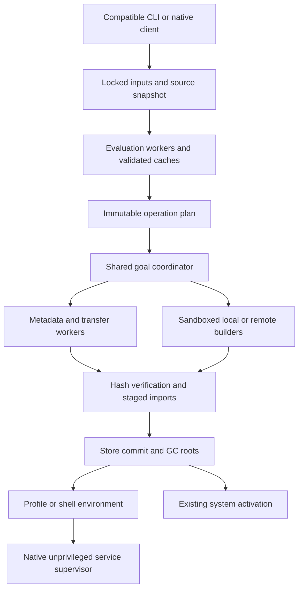

# Performance architecture and optimization plan

Status: evaluator measurements updated 2026-10-27; the current-main diagnosis and the evaluator cost reductions below are exploratory five-pair runs. The [runner](../benchmarks/README.md) supports 39 subsets of the 154 catalog scenarios. O06 bounds immutable source capture with an 8 MiB spool threshold; O09 indexes dependency edges while retaining serial realization and ready ordering. EVAL-08 now covers the qualification NixOS and Home Manager derivation paths. The remaining hypotheses and unimplemented parts of those hypotheses remain proposed work. The [benchmark specification](performance-benchmarks.md), [scenario catalog](../benchmarks/catalog.tsv), and [CppNix research](performance-research.md) define the evidence required before advertising an optimization.

## Qualification evaluator measurements, 2026-10-25

EVAL-08 evaluates the exact four derivation paths from `just nixos-paths`: the qualification NixOS system, its VM, its Home Manager module generation, and a standalone Home Manager generation. Nixpkgs is locked at `e94cb152ed51bd6e24eb4a41f1460252beb52cd2` and Home Manager at `7b4c5ec4bedaf1e062bbc1bcaeddbc6bd242aa1b`. Every engine must independently match all four recorded paths as strict JSON and then match the pinned reference. Host Nix resolves the source paths outside timing; each timed engine evaluates the modules itself against a read-only dummy store.

The final run, `target/benchmarks/eval-hotpaths-final-30`, contains 30 shuffled matched blocks with five release artifacts, plus one preflight per artifact. All 155 invocations passed. Builds used the normal portable release profile through `devenv shell -- just bench-build`. All engines inherited affinity `0-3,12-15` on an AMD Ryzen AI 9 HX 370, four physical faster cores with their SMT siblings. This is a fixed-resource lane: those cores advertise 5.16 GHz versus 3.29 GHz for the other cores. The governor remained `powersave`; OS page cache and other host activity were uncontrolled. These are fresh CLI processes and isolated application state.

Wall and process-tree CPU times are medians. RSS and cgroup memory columns are medians of each invocation's peak. Cgroup memory includes charged page cache and is distinct from target process RSS. Step speedups are paired geometric means with 2,000-resample bootstrap intervals; the final column is the ratio of wall-time medians.

| Engine / cumulative change | Wall s | CPU s | Peak RSS MiB | Cgroup peak MiB | Speedup over preceding nix-rs, 95% CI | Wall / CppNix |
| --- | ---: | ---: | ---: | ---: | --- | ---: |
| CppNix 2.35.2 | 3.186 | 4.143 | 979.4 | 967.0 | n/a | 1.000x |
| Original nix-rs, `569e1b3` | 22.927 | 22.839 | 4,694.8 | 4,697.7 | baseline | 7.197x |
| Direct captures, `04469d5` | 21.737 | 21.656 | 4,612.4 | 4,615.4 | 1.053x [1.044, 1.060] | 6.824x |
| Memoized forcing, `2fe6949` | 20.450 | 20.377 | 4,612.7 | 4,615.3 | 1.065x [1.058, 1.075] | 6.419x |
| Shared mapped-call bytecode, `772d833` + `a77b06f` | 19.526 | 19.419 | 3,240.5 | 3,241.0 | 1.047x [1.041, 1.054] | 6.129x |

The cumulative paired speedup is 1.175x, 95% interval [1.170, 1.180]. The wall-time medians differ by 3.401 s, a 14.8% reduction. Median peak RSS fell by 31.0%; the largest observed target RSS was 4,695.1 MiB for the original and 3,241.2 MiB for the final candidate. Evaluation still takes 6.1 times the reference's median elapsed time, so TODO section 3's near-reference gate remains open. These measurements qualify this four-path workload in this resource lane.

The changes address costs identified by flat `cycles:u` profiling:

- Directly install populated captures when constructing VM thunks and closures, reserve the known capture count, and remove redundant reference-count operations. This avoids allocating a capture vector only to replace it immediately.
- Read fully memoized thunk values directly in bytecode and builtin force/try-force requests. Suspended thunks, blackholes, and evaluated thunks pointing to another thunk retain the normal forcing path.
- Share one generated application lambda per invocation of `map`, `mapAttrs`, `genList`, and `zipAttrsWith`. Each resulting thunk keeps its own argument and callee captures. Empty results return before allocating application bytecode. The ordinary suspended-thunk machinery, source spans, and error types remain unchanged.

After timing, fresh controlled profiles of the preserved original and final artifacts used the same isolated environment and affinity. `perf record -e cycles:u -c 10000000` collected 10,756 and 9,211 samples respectively, with zero lost samples; both profiling invocations also matched the four-path oracle. The visible libc allocation/free/reallocation routines account for approximately 22% of original samples and 19% of final samples. In the final profile, bytecode dispatch accounts for 9.71%, generator dispatch for 8.20%, and thunk forcing for 5.11%. These fractions describe a smaller total cycle count, approximately 107.56 billion original versus 92.11 billion final, and do not replace the 30-block timing estimate. Further evaluation-time work needs to address the remaining VM/generator and value-management costs. Raw data, flat reports and exact commands/environments are in `target/benchmarks/profiles/controlled-{original,candidate}.{data,txt,json}`; `target/benchmarks/profile-eval.py` reproduces them. The host rejected frequency sampling and call-stack capture, so these are fixed-period, user-space flat profiles.

The reference-generated `eval-okay-shared-mapped-call-captures` fixture checks empty-result laziness and independent captured values for all four builtins. Full CI passed 2,726 nextest tests with five skipped and all doctests; all twelve benchmark-runner tests passed. Both `just nixos-paths` and `just nixpkgs-paths` passed unchanged after every optimization stage.

The original release and each intermediate artifact, source identities, exact arguments and isolated environments, fixture digest, CPU/I/O counters, target RSS, cgroup memory, stdout/stderr, and manifest are retained under `target/benchmarks/`. The final manifest's 470 files and every measured binary digest were verified. `eval-hotpaths-final-30-adjacent-summary.json` and `analyze-eval.py` retain the adjacent-stage analysis outside the sealed run directory. Preliminary `eval-baseline`, `eval-captures`, and `eval-forced` runs were exploratory; the partial `eval-hotpaths-30` and `eval-hotpaths-bigcores-30` matrices were stopped to control affinity and remove empty-result allocation respectively. Their samples are not pooled with the final run.

Reproduce the final matrix after preserving artifacts as described in the benchmark README:

```sh
devenv shell -- taskset -c 0-3,12-15 just bench target/nix-reference/bin target/benchmarks/eval-final/bin target/test-busybox --baseline-bin target/benchmarks/eval-forced-baseline/bin --comparison-bin original=target/benchmarks/eval-original/bin --comparison-bin captures=target/benchmarks/eval-captures-baseline/bin --case EVAL-08 --samples 30 --timeout 300 --output target/benchmarks/eval-hotpaths-repeat
```

## Second evaluator round, 2026-10-26

The preserved round-one release in `target/benchmarks/eval-final/bin` is the baseline for this round (19.526 s median wall time and 3,240.5 MiB median peak target RSS in the preceding controlled run). Builtin values now share immutable metadata with copy-on-write partial arguments; completing an application copies only captured arguments when necessary. The `eval-okay-shared-builtin-partials` reference fixture checks independent reuse of those captures. Non-async builtin bodies also register a synchronous entry point: fourteen type predicates, list operations and attribute lookups can bypass generator construction when all strict arguments are ready. Suspended arguments retain the existing generator and forcing order; lazy arguments remain untouched. Macro tests cover both paths, catchable propagation and captured state. No error types changed.

The exploratory runs `round2-shared-5` and `round2-shared-3` were interrupted because concurrent worktree builds caused substantial host memory pressure and swapping. Their completed invocations matched the independent path oracle, but their timings are not used to claim an improvement. New performance claims require a fresh fixed-affinity matched comparison.

The bytecode dispatcher now continues directly after a partial builtin application or successful synchronous call, avoiding a frame push/pop, another outer dispatch and a source-span lookup. Suspending calls and errors retain the caller frame and its original span. A release differential check covers 46 success, error, catchable, partial-application and control-flow expressions, preserving exit status, stdout and full trace stderr against the preceding artifact.

## Current merged evaluator diagnosis, 2026-10-26

A fresh portable release of main `a7548847` was compared with the preserved round-one release and pinned CppNix 2.35.2 on EVAL-08. The same fixed affinity `0-3,12-15`, locked inputs, read-only dummy store and independent four-path JSON oracle were used. The host passed a 20-second quiet-window check before collection; maximum full memory PSI remained 0.00% throughout. No compilation overlapped the timed run. Application state was isolated, but OS page cache and unrelated host activity were not controlled. These five shuffled matched blocks are diagnostic evidence, not a replacement for the earlier 30-block qualification or a general package-management score. All fifteen timed invocations and three preflights matched the oracle.

| Engine | Median wall s | Median process-tree CPU s | Median peak target RSS MiB |
| --- | ---: | ---: | ---: |
| CppNix 2.35.2 | 3.267 | 4.226 | 966.4 |
| Preserved round-one nix-rs | 20.064 | 19.952 | 3,240.2 |
| Current main, `a7548847` | 22.878 | 22.776 | 3,324.0 |

Current main takes 7.00 times the reference's elapsed time and 3.44 times its peak RSS in this small run. It also takes 14.0% longer than the preserved nix-rs release and uses 2.6% more peak RSS. Current-main wall times span 22.558-23.332 s; reference times span 3.227-3.272 s. The earlier 19.526 s result does not describe the newly merged tree. Median physical disk reads and writes were zero for both engines, and nix-rs's CPU time is nearly equal to elapsed time: the measured delay is evaluation work, rather than downloads, building or an idle process waiting on those services.

Fixed-period user-space `cycles:u` profiles were collected separately from timing for all three artifacts. Call stacks were unavailable under the host's `perf_event_paranoid=2` policy, so these are flat, exclusive symbol samples, not inclusive call-tree costs. The current, preceding and reference profiles contain approximately 109.84, 95.36 and 19.12 billion sampled-event cycles respectively, with zero lost samples. Function boundaries and inlining differ between artifacts; percentages alone cannot isolate the causal effect of an individual commit.

The current profile assigns 18.99% to libc allocation/free symbols, 10.28% to bytecode dispatch symbols, 7.60% to generator driving/resumption, 3.81% to bytecode operand decoding, 3.97% to thunk forcing, 2.59% to capture population, 3.39% to value-cloning symbols and 2.39% to libc memory copying. Generator re-enqueueing adds 2.55%. These paths support the primary diagnosis: the evaluator performs substantial scheduling, ownership and data-management work per lazy language operation. Parser/compiler symbol groups account for 5.04% of this flat profile, so parser replacement is a lower-priority hypothesis for this workload.

The source explains the mechanisms. `vm/generators.rs` represents resumable work as `Gen<VMRequest, VMResponse, Pin<Box<dyn Future<...>>>>`; forcing an unready value can re-enqueue one frame, allocate another generator and return through the outer VM loop. `Thunk` uses `Rc<RefCell<ThunkRepr>>` and a separate `Rc<Upvalues>` containing vectors of captured values. Shared attribute-set updates can clone their backing maps. The pinned CppNix source instead forces a thunk through its expression and environment pointers, batches value allocation in `EvalMemory::allocValue`, and uses compact interned symbols and attribute bindings. This is an implementation and representation gap; these profiles do not establish an inherent Rust-versus-C++ cost or prove that a VM is necessarily slower than an AST evaluator.

The memory policies also differ. The default nix-rs command enables `impure`, not the evaluator's optional `no_leak` feature. Its context-free `NixString` allocations are deliberately not freed, allowing pointer-copy clones; `Rc` alone cannot collect reference cycles in the lazy value graph. Enabling `no_leak` is not an established fix: it changes string cloning/deallocation costs and requires its own matched measurement. A separate CppNix `NIX_SHOW_STATS` invocation, excluded from timing, reports 19,360,824 values, 9,713,630 environments and 3,026,115 attribute sets containing 23,899,850 attributes. Its value and attribute entries are each 16 bytes. Four GC cycles manage about 1,073.4 MiB of total GC allocations, leaving a 720.3 MiB GC heap after the final collection. This illustrates how per-object overhead and reclamation matter at this scale; there is no allocation-stack or retained-heap breakdown yet assigning nix-rs's extra memory to specific object classes.

Recent diagnostics add measurable work on successful evaluation too. `FrameTrace` cloning and dropping account for 3.20% of current samples, and source-span lookup for 2.59%; the frame loop clones trace metadata at each transition, generator suspension clones it again, and function calls retain parent frames for accurate traces. The old artifact has no `FrameTrace` clone/drop symbols. These are credible contributors to the observed regression, but this comparison includes many other semantic changes and compiler/inlining differences. It does not attribute the full 14.0% slowdown to diagnostics. Trace rendering remains necessary for compatibility; the experiment to prioritize is a cheaper representation and deferred materialization that preserves the same errors and call sites.

The next experiments should measure compact frame/continuation state and additional synchronous forcing paths, allocation count and retained bytes by object class, and trace bookkeeping separated from error materialization. Attribute-map sharing and compact capture storage are candidates after that attribution. Swapping an allocator or removing the measured libc allocation/free time alone cannot close this gap: eliminating that 18.99% symbol bucket entirely would yield only about 1.23 times the speed. New optimizations still require per-change comparison with both preserved nix-rs and pinned CppNix, exact diagnostics, and unchanged `just nixos-paths` and `just nixpkgs-paths` results.

Raw diagnostic artifacts are in `target/performance-diagnosis-2026-10-26/`: `matched-5/` contains samples, manifests, environments, correctness results and hardware; `main/` preserves the executable and source identity; `host-state.jsonl` records the quiet-window/pressure checks; `profiles/` contains the three perf captures, symbol reports, summarized groups and reference allocation statistics. `diagnostic-summary.json` records the measured medians. No evaluator implementation was changed for this diagnosis. A recovery copy of these artifacts is preserved at `/home/rajveer/.local/state/nix-rs-performance-diagnosis/2026-10-26-a7548847`.

## Evaluator cost reductions, 2026-10-27

The changes below address the mechanisms the diagnosis named. Each is its own commit, checked against its predecessor by user-space instruction counts (`perf stat -e instructions:u`), which stayed stable while wall time varied with unrelated host load. Every candidate also ran a differential against the merged-main artifact. That differential covers 362 language fixtures and 34 extra expressions (errors, catchable errors, `tryEval`, assertions, infinite recursion, `with`, selection and deep-force traces), each with and without `--show-trace`, and compares exit status, stdout and stderr. All outputs were identical for every kept change. The workspace tests, doctests, `just nixos-paths` and `just nixpkgs-paths` pass at the final revision.

| Change | EVAL-08 effect |
| --- | --- |
| Move a generator's trace into the running frame instead of cloning it per transition; skip the clone for trace-less bytecode frames | with the next change, 5.4% fewer instructions |
| Record each suspended thunk's span at compile time instead of a binary search per thunk | included above |
| Force a plain suspended bytecode thunk by entering its code directly under a `Force` frame, which stands in for the `force` generator one for one: same frame indices, spans, error chains, traces and blackhole | 17.9% fewer instructions |
| Allocate with mimalloc in `nixrs` and the `nix-rs-commands` executables | 8.2% fewer instructions, 5% lower peak RSS |
| Box lambda formals and release chunk spare capacity; a lambda allocation drops from 320 to 240 bytes | peak live heap about 140 MiB lower |
| Store static upvalues as a boxed slice and share captured `with` stacks; `Rc<Upvalues>` drops from 64 to 48 bytes | peak live heap about 130 MiB lower |
| Fat LTO with one codegen unit for release builds | 4.7% fewer instructions |
| Test for a catchable error inline before tracing a result | 0.6% fewer instructions |
| Share the attribute-position map of sets built from one literal when their positions match, and stop deep-copying it with the set | about 110 MiB lower peak RSS, 1% fewer instructions |

Together the user-space instruction count fell from 231.4 to 158.2 billion. Rebuilding the merged-main baseline and the pre-mimalloc revision with the newer nightly gave the same instruction counts, so the toolchain update in the same period does not account for these differences.

A five-pair matched run with the repository runner then compared the final revision `1018a06d` with the preserved round-one release and pinned CppNix 2.35.2, using the same affinity, inputs, dummy store and oracle as the diagnosis. The host was not quiet; the CPU times below are less affected by that than wall times. All fifteen timed invocations matched the oracle.

| Engine | Median wall s | Median process-tree CPU s | Median peak target RSS MiB |
| --- | ---: | ---: | ---: |
| CppNix 2.35.2 | 3.318 | 5.117 | 994.1 |
| Preserved round-one nix-rs | 20.246 | 20.082 | 3,240.5 |
| Final revision, `1018a06d` | 15.170 | 15.088 | 2,937.3 |

The final revision is 1.35 times as fast as round one (95% interval 1.31-1.39), which reverses the merged tree's 14% regression, and uses 9% less peak RSS. It still takes 4.57 times CppNix's elapsed time and 2.95 times its peak RSS.

Three experiments were rejected. The `no_leak` feature raised peak RSS to 3.98 GB because it also disables string interning, and it ran more instructions, so leaked context-free strings are not the memory problem. Sharing captured `with` stacks alone gained under 1%; it was kept only as part of the compact upvalue representation. A synchronous fast path for `==` between evaluated scalars saved 1.2% of instructions, below the 2% bar for this round.

The remaining gap is architectural. Builtins, comparisons, equality and string coercion still run as boxed generators. A thunk cell takes 56 bytes, and about 9 million are live at peak, against CppNix's 16-byte values. `//` copies its maps, as CppNix also does. `Rc` cannot collect reference cycles without a collector. A live-size histogram at peak attributes about 480 MiB to thunk cells, 330 MiB to upvalues, 230 MiB to lambdas and 590 MiB to allocations of a kilobyte or more, which include source text and attribute tables. These need representation changes, not further local fixes.

Raw artifacts are in `target/performance-tip-2026-10-27/`: `bin/` holds the measured executables, `matched-5/` the runner samples and report, `summary.txt` the medians, and `differential/` the differential and instruction-count scripts. A recovery copy is at `/home/rajveer/.local/state/nix-rs-performance-tip/2026-10-27-1018a06d`.

## What should become faster

Measure time until an installed package actually runs, a development shell executes its first command, development services pass readiness checks, and a system generation completes activation. Download completion, derivation evaluation, and a CLI returning early are intermediate milestones.

The strongest architectural change is to share a validated operation plan and deduplicate work across evaluation, closure discovery, substitution, building, and environment creation. Then overlap independent work within explicit CPU, memory, network, disk, and build-user limits. A faster interpreter alone cannot remove network latency, filesystem metadata writes, compilation, shell hooks, or service restarts.

For an operation whose evaluation consumes 20% of elapsed time, even eliminating evaluation leaves at most a 1.25x overall improvement if the other work stays fixed. Phase attribution and the dependency graph must guide investment. Proposed targets below are engineering goals, not forecasts.

The first reference remains CppNix 2.35.2 at `2c73b59da29606068c0c98db015dd3a66955525d`, verified against `flake.lock`. Nixpkgs, NixOS, and Home Manager use the separately pinned [qualification inputs](../tests/qualification/flake.lock). A newer reference belongs in a separate report; do not silently move this baseline.

## Existing architecture and the comparison boundary

| Area | Current nix-rs evidence | Consequence for the plan |
| --- | --- | --- |
| Evaluator | [Evaluation](../crates/nix-rs/eval/src/lib.rs), compiler/VM, and [thunks](../crates/nix-rs/eval/src/value/thunk.rs) use lazy evaluation and `Rc<RefCell<...>>` values. The `no_leak` feature is explicitly a temporary memory option in [Cargo.toml](../crates/nix-rs/eval/Cargo.toml). | Benchmark the current VM before proposing JIT compilation or concurrent thunk forcing. Long-lived evaluator processes need bounded retention and user isolation first. |
| Source ingestion | [CapturedImport](../crates/nix-rs-glue/src/store.rs) now hashes into an immutable spool that spills beyond 8 MiB, then ingests those same bytes. | The bounded-capture portion of O06 is implemented. Snapshot reuse and removing repeated ingestion passes remain open. See the [initial measurements](performance-benchmarks.md#initial-local-results) for lower target RSS, extra file-cache work and unproven latency gains. |
| Realization planning | [LocalBackend](../crates/nix-rs-build/src/backend.rs) now uses reverse edges and dependency counters to compute topological order; realization remains sequential. [LocalBuilder](../crates/nix-rs-build/src/local.rs) also recursively realizes inputs. | The scan removal implements part of O09. A shared goal graph, parse reuse and bounded parallel execution remain open. Preserve reference failure propagation and settings. |
| Substitution | [BinaryCache](../crates/nix-rs-store/src/binary_cache.rs) already reuses an HTTP agent and streams NAR decompression. Its closure substitution visits references recursively and serially; [query_missing](../crates/nix-rs-build/src/missing.rs) independently queries cache metadata. | Share metadata and in-flight requests between planning and realization. Target serial dependency discovery, duplicated requests, and bounded overlap; do not claim existing NAR streaming as new. |
| Store metadata | [LocalStore](../crates/nix-rs-store/src/local.rs) uses a mutex around one SQLite connection. `register_valid_paths` already batches a transaction and uses prepared statements; [database opening](../crates/nix-rs-store/src/db.rs) already supports WAL. [Store::compute_closure](../crates/nix-rs-store/src/api.rs) queries one path at a time. | Measure query counts, lock waits, and transaction sizes before adding reader pools, bulk closure queries, or a metadata cache. WAL and transactions are existing behavior. |
| Daemon | [server](../crates/nix-rs-daemon/src/server.rs) forks per client and opens its store in the child. The [client](../crates/nix-rs-daemon/src/client.rs) already retains one connection. | Shared scheduling across clients would require a coordinator and isolated workers, not a mechanical conversion to async functions. Cross-engine protocol pairings remain required. |
| Measurements | [Criterion evaluation benches](../crates/nix-rs/eval/benches/eval.rs), the differential evaluator, reference command tests, and VM qualification already exist. | Reuse their fixtures and oracles. Criterion currently discards evaluation results, and the small/large merge expression lacks a semicolon after `c = 3`; check validity and forced results before treating these benches as evidence. This plan does not repair them. |

CppNix already has lazy evaluation, a persistent flake evaluation cache, shared HTTP transfer machinery, parallel substitutions, a goal scheduler, SQLite WAL, transaction batching, and NAR streaming. The [research appendix](performance-research.md) links the pinned implementation. Rust, async I/O, content addressing, and parallelism do not establish a performance advantage by themselves.

Compatibility commands must retain Nix expression semantics, store paths, NAR bytes, signatures, settings, locking, GC roots, sandbox isolation, daemon protocol behavior, profiles, shell hooks, errors, and activation contracts. Optimization cannot mean disabling checks or doing less work than CppNix. Native environments and experimental storage transports have separate qualification and explicit opt-in behavior.

## Proposed operation architecture



This is a candidate design. Keep compatible synchronous adapters while introducing internal operation-scoped bulk APIs and worker queues. Do not make the entire `Store` trait async or add `Arc` to every evaluator value as a prerequisite.

- A plan records selected outputs, exact input identities, derivation graph, required store paths, metadata observations, operation settings, and effects that still need execution. Record provenance and a schema version; never persist credentials in plans.
- Plans are reusable only while their dependencies and policy remain valid. Recheck path validity, trust, permissions, roots, and mutable inputs at execution. A plan is not authorization and cannot promise that all substitutes remain available.
- The coordinator deduplicates compatible goals by output identity and relevant settings. Two requests with different repair/check modes, trust policy, credentials, sandbox requirements, or output selections cannot blindly share a result.
- Worker pools keep CPU hashing/decompression, blocking filesystem/SQLite work, network I/O, evaluation, and build processes under separate limits. A queue carries an estimated memory cost as well as a job count.
- One cancelled subscriber must not kill work still needed by another. The final subscriber releases or cancels work according to its state; temp roots stay live until publication or cleanup. Recover from coordinator loss without declaring staged paths valid.
- Store publication retains atomic visibility and reference validation. Limit batch size and commit delay so a large closure does not starve interactive queries or enlarge crash recovery indefinitely.
- Separate trusted store operations from evaluation and user runtime services. A long-lived evaluator handles immutable pure inputs in isolated workers, with quotas and recycling. A development service supervisor remains unprivileged.

## Optimization inventory

Each row states the full hypothesis. Benchmark identifiers refer to [catalog.tsv](../benchmarks/catalog.tsv); `partial` rows have subset adapters. `P1` means an early experiment after baseline tooling, `P2` means later work justified by profiles, and `P3` means exploratory or additive work. These are performance priorities, not a replacement for [MVP gates](../TODO.md).

| ID | Candidate shift and expected mechanism | Priority and owner | Benchmark families | Conditions that can reject it |
| --- | --- | --- | --- | --- |
| O01 | Load settings and command modules only when needed; keep `--version` and pure evaluation off the store/network path. | P1, commands/CLI | START, EVAL | Changes settings discovery, diagnostics, or misses real cold-start costs. |
| O02 | Cache parsed/compiled immutable inputs; optimize measured VM dispatch and hot builtins. Compare bytecode specialization or JIT only after VM profiles show a CPU bottleneck. | P2, eval | EVAL, MEM | Compilation costs exceed savings, cache versioning fails, or error spans/laziness change. |
| O03 | Intern attribute names and immutable strings; compare compact values, arena lifetimes, and representation changes against current `Rc` ownership. | P2, eval | EVAL, MEM | Extra retained memory, aliasing bugs, recursion behavior changes, or cold workloads regress. |
| O04 | Persist dependency-tracked results for immutable pure evaluation; invalidate affected entries rather than reevaluate every output. Cache successful immutable values and required derivation metadata first. | P2, eval/glue | EVAL, FETCH, FAIL | An input read is untracked, effects disappear, error replay differs, or cache validation costs more than evaluation. |
| O05 | Reuse bounded evaluator workers across requests; parallelize independent output evaluations with isolated heaps before considering shared-thunk concurrency. | P2, eval/daemon | EVAL, RPC, MEM | `Rc` values cannot cross workers, repeated imports multiply memory, state leaks across users, or workers grow without bound. |
| O06 | Capture source bytes once into a bounded memory buffer or immutable spool; reuse content-verified snapshots and filtered manifests. | P1, glue/store | FETCH, NAR, MEM, FAIL | Hashing and ingestion observe different bytes, directory filters or executable bits change, or warm reuse trusts only timestamps. |
| O07 | Resolve locked input graphs once; coalesce identical Git/archive fetches and reuse verified trees. Pipeline independent locked fetches. | P2, fetcher/input module | FETCH, ENV | Dirty-tree, `follows`, credential, submodule, registry, TTL, or lock-update semantics change. Fetchers must exist and pass compatibility first. |
| O08 | Pass an immutable typed plan through evaluate, query-missing, realize, profile, and shell stages; avoid recomputing derivations and closures. | P1, glue/build/commands | PLAN, ENV, SYS | A stale observation skips revalidation, import-from-derivation effects change, or plan serialization costs more than the duplicated work. |
| O09 | Index reverse graph edges and dependency counters; remove the waiting-map scan and repeated derivation parsing from scheduling. | P1, build | PLAN, DAG | Incremental/dynamic dependencies become incorrect, memory use exceeds the graph budget, or ready/failure ordering diverges from required semantics. |
| O10 | Execute ready build and substitution goals concurrently with bounded resource queues; deduplicate shared dependencies across clients. Experiment with critical-path prioritization only where ordering is permitted. | P1, build/daemon | DAG, BUILD, CACHE, FAIL | Ignores `max-jobs`, `cores`, keep-going, fairness, build-user limits, output locks, or reference diagnostics. `cores` is a builder hint, not a reliable host reservation. |
| O11 | Share HTTP agents and bounded narinfo caches with positive/negative TTLs; reuse connections and credentials safely, respect cache priority and server backoff. | P1, store/cache | CACHE, RPC, FAIL | Stale misses hide new outputs, trusted keys change without revalidation, or racing mirrors change required selection/errors. |
| O12 | Fetch independent closure metadata concurrently and share it between planning and substitution; deduplicate identical in-flight narinfo/NAR requests. | P1, store/build | CACHE, PLAN, DAG | Standard caches do not provide a bulk endpoint, speculative requests waste bandwidth, or closure cycles and missing references are mishandled. Use standard per-path requests by default. |
| O13 | Overlap NAR transfer, decompression, hashing, reference checks where required, and staged extraction with byte-budgeted buffers. | P1, store/NAR | NAR, CACHE, MEM, FAIL | A path becomes visible before integrity checks, pipeline stages duplicate full archives, or concurrency overloads disk and increases tail latency. |
| O14 | Tune codec workers/buffers and use supported optimized hashing implementations; preserve wire-declared algorithms and canonical NAR traversal. | P2, hash/store/build | NAR, BUILD | Gains require changing existing cache compression, hash algorithms, signatures, or NAR bytes. More codec workers may reduce install throughput under CPU limits. |
| O15 | Add measured bulk metadata queries, transaction chunking, and read connections around a controlled write path using the compatible SQLite schema. | P1, store | DB, RPC, GC | Existing WAL/batching already removes the cost, snapshot inconsistency appears, writer starvation grows, or mixed CppNix access breaks. |
| O16 | Cache immutable path metadata and parsed derivations within operations; use bounded shared caches only with cross-process invalidation or fresh validity checks. | P2, store/build | DB, PLAN, GC, FAIL | GC, repair, signature changes, or another engine makes entries stale. A daemon-local epoch cannot detect CppNix writers by itself. |
| O17 | Use existing protocol bulk operations where available, retain connections, and pool independent ordered connections for concurrent requests. Negotiate new bulk operations only as extensions. | P1, daemon/client | RPC, DB, NAR | Interleaves frames on a sequential legacy stream, reuses the wrong client options, or breaks any CppNix client/server pairing. |
| O18 | Add a long-lived goal coordinator and bounded isolated workers to replace repeated per-client planning. Compare the cost and isolation of processes versus threads. | P2, daemon | START, RPC, DAG, MEM, FAIL | A crash affects all clients, a user shares another's policy or credentials, or unsafe fork-after-threads enters the design. Keep sandbox process launch isolated. |
| O19 | Cache immutable sandbox input manifests and reduce repeated closure/mount planning; use kernel-supported copy/mount operations behind the same isolation contract. | P2, build/sandbox | BUILD, DB, FAIL | Reuses mutable namespaces or build directories, changes allowed paths/network, or setup savings vanish on real builds. |
| O20 | Reuse authenticated remote connections, send only missing verified inputs, and schedule against measured queue/transfer/build costs within reference constraints. | P2, build/remote | REMOTE, DAG | Remote support is incomplete, scheduler policy changes observable constraints, or predicting a faster builder increases transfer cost and failure risk. |
| O21 | Reuse sorted profile manifests and merge selected output trees once; retain collision/priority handling and atomic generations. | P2, buildenv/profiles | PROFILE, ENV | Skips user-environment builders or hooks, changes collisions/priorities, or invalidates rollback roots. Native fast paths need matching artifacts. |
| O22 | Cache validated shell environment capture and realized closures; entry still runs the required shell hooks and child setup. | P2, commands/environment planner | ENV, FETCH, FAIL | Caches a side effect, restores secrets, omits hooks, misses changed shell packages, or changes TTY/signal behavior. |
| O23 | For native `nixrs env`, reuse a frozen plan and start independent tasks/services concurrently using explicit dependency and readiness rules. | P2, native environment supervisor | ENV, MEM, FAIL | Says ready before health checks, skips initialization/tasks, races service data, or misattributes benefits to the package manager when the comparator lacks equivalent services. |
| O24 | Reuse evaluation/realization plans for system and Home Manager operations; optimize their pre-activation preparation and preserve generated activation order. | P2, system operations | SYS, PLAN | Skips activation scripts or required restarts. Service migration and activation remain semantic lower bounds. |
| O25 | Batch closure/GC queries, use indexed reachability and bounded parallel deletion only under the existing root/lock protocol. | P2, store/GC | GC, DB, FAIL | Deletes a newly rooted path, mishandles hardlinks, or exposes inconsistent roots to another engine. |
| O26 | Compare filesystem reflinks, copy-range support, and deduplication indexes for import/copy/optimization, retaining canonical modes and metadata. | P2, store/filesystem | NAR, GC, BUILD | Assumes filesystem support, changes hardlink accounting, relies on unsafe source mutation, or copy-on-write later amplifies disk use. |
| O27 | Bound progress/log queues and batch rendering; offer tracing spans off the hot path while preserving compatible output. | P1, logging/commands/daemon | START, RPC, BUILD, SYS | Drops required logs, changes output ordering, or lets a slow client block unrelated builds. |
| O28 | Compare allocators, codegen units, LTO, PGO, and CPU dispatch using portable release artifacts and representative training inputs. | P2, packaging/eval | START, EVAL, NAR, MEM | Uses debug versus release comparisons, overfits PGO to measured workloads, increases binary/startup costs, or loses supported CPUs. |
| O29 | Explore an optional chunked content store with verified NAR import/export and ordinary path materialization; reduce repeated content transfer and storage. | P3, experimental store | EXT, NAR, GC | Requires rewriting the shared store, alters paths/NAR interoperability, or spends more on indexing and materialization than it saves. Nix already has content-addressed paths; chunking is the proposed difference. |
| O30 | Explore an opt-in lazy materialization backend for immutable read workloads. Measure first use, all-use completion, page faults, offline access, and missing-content recovery. | P3, experimental store | EXT, ENV, SYS | A quick shell start hides later fetches, boot needs unavailable network data, or it cannot support mmap, executable files, permissions, and ordinary store verification. |
| O31 | Explore negotiated chunk/delta transfer against an owned cache, retaining hashes, signatures, and standard-cache fallback. | P3, experimental cache | EXT, CACHE, REMOTE | No compatible endpoint exists, encode/index CPU outweighs bytes saved, or delta failure cannot fall back safely. Report separately from drop-in substitution. |
| O32 | Reuse identical per-platform plans/closures across fleet targets, distribute verified artifacts, and bound activation batches with health gates. | P3, fleet operations | EXT, REMOTE, SYS | Treats heterogeneous targets as identical, hides per-machine failure, or claims distributed activation is atomic. This follows single-machine OS qualification. |

## Cache correctness before cache speed

O04, O07, O08, O16, and O22 need different cache keys and invalidation rules. Do not build one global cache whose key is only a flake revision.

| Cached object | Required identity and validation | Never infer validity from |
| --- | --- | --- |
| Parsed or compiled source | Content digest, logical source identity for paths/spans, parser/compiler version, evaluator feature settings. | mtime alone, path name, or a watcher event stream. |
| Pure evaluated result | Evaluator/build semantics version, source graph, selected output, system, overlays/module arguments, settings, search path, observed reads including missing paths/directory listings and indirect imports, and required string context. | A lock hash without the root source, dirty working tree, or argument identity. |
| Impure evaluation | Default to operation-local reuse. Persistent reuse requires explicit tracking of every external dependency and effect; time, environment reads, network observations, traces, and import-from-derivation prevent a blanket pure-result policy. | Calling an expression pure because its imports are locked. |
| Narinfo/closure metadata | Cache URI and credential scope, store path, trust policy/key version, expiry, error class, and path validity. Bound negative entries and distinguish absence from transient failure. | A previous 404 forever or another user's authenticated request. |
| Realization plan | Evaluation identity plus requested outputs, build/repair/check settings, observations and expiry; recheck local validity, trust, available substitutes, and permission before executing. | A persisted ready flag or an old daemon instance ID. |
| Captured shell environment | All derivation and shell outputs, environment-capture inputs, shell/version, relevant settings, and closure validity. Filter secrets; required runtime hooks still execute. | A shell name, unchanged flake lock, or PATH alone. |
| Native service plan | Environment identity, task/service definitions, session/data identities, executable closure, declared readiness dependencies, and observed runtime state. | Another session's process IDs or yesterday's readiness result. |

Content-addressed cache entries can be immutable, but their reachability, permissions, trust, and referenced store objects still change. File watchers are invalidation hints. Content checks or a validated filesystem snapshot establish identity. Bound bytes retained, not only entry count, and expose hit/miss/invalidation counters.

## Measurement goals and stop rules

After collecting baselines, select targets per workload and machine. Initial candidate goals are at least a 20% reduction in a confirmed CPU/metadata bottleneck or a 2x reduction in a repeated pure-evaluation workload. They do not promise a 2x package install or system switch. A cold install limited by compressed bytes divided by network throughput will improve only if bytes fall or unnecessary round trips disappear.

Every accepted experiment must satisfy these conditions:

- Pass the affected differential and failure oracles before counting any timed sample as a success.
- Show the mechanism in counters, such as fewer narinfo requests, derivation reads, allocations, graph visits, SQL calls, or lock waits. Measure the optimized phase and at least one user workflow.
- Compare with both the pre-change nix-rs artifact and pinned CppNix, using identical work and resource settings. Report milliseconds saved, ratios, memory, CPU, bytes, and disk effects.
- Use the predeclared decision rule in the benchmark spec. Small/noisy gains, cold-path regressions, or displaced latency into first package use are reasons to reject or narrow the feature.
- Include short-lived and long-lived behavior. A persistent daemon that makes the second request faster but accumulates memory is incomplete.
- Retain an off switch for persistent caches, scheduling policies, and experimental backends until their recovery and interoperability evidence is complete.

## Work sequence

| Step | Deliverable | Exit evidence |
| --- | --- | --- |
| 0 | This architecture plan, sourced CppNix audit, scenario catalog, benchmark protocol, links from product/development/verification docs. | Catalog and cross-reference validation. No performance result claimed. |
| 1 | A differential timing runner with isolated homes/stores, versioned result records, capability discovery, deterministic fixtures, timeouts, process-tree accounting, and cleanup. Repair the existing evaluator benchmark validity/forcing checks. | Runner rejects fast failures and mismatched work; paired START/EVAL/DB/NAR/PLAN cases produce reproducible reports. |
| 2 | Offline synthetic fixtures and local signed cache server, controlled faults/latency, process profiling spans/counters, and cross-engine daemon pairings. | CACHE/DAG/BUILD/RPC/PROFILE baseline matrix with correctness digests and byte/request counts. |
| 3 | O06, O08, O09, O11, O12, O13, O15, O17, and O27 as individual measured experiments. Start with repeated metadata work and indexed graph planning, then concurrency. | Ablation reports versus pre-change nix-rs and CppNix; affected tests and crash/recovery cases pass. |
| 4 | O10 bounded shared goals and O18 coordinator experiment after single-operation scheduling and roots are reliable. | Contention, fairness, cancellation, output-lock, GC, client isolation, and mixed-engine evidence. |
| 5 | Real locked Nixpkgs/NixOS/Home Manager and standard shell workflows as capabilities land. Consider evaluator caching/representation and O19/O20/O21/O22/O24 only from phase profiles. | Repeatable package-use, shell-command, and activated-system milestones, with unsupported cases visible. |
| 6 | Native environment readiness benchmarks once that extension exists; service startup experiments and memory-soak evidence. | Equivalent tools/services/hooks, verified readiness and teardown. Native results remain separate from CppNix parity results. |
| 7 | Experimental chunk store/lazy materialization/delta transfer and fleet reuse, each with its own decision record and opt-in protocol/backend. | Full-use and offline/recovery results, compatibility export/import, demonstrated limits, and no migration of the default store. |

Performance measurement starts during the MVP. Removing unnecessary work can happen before the OS release when affected compatibility passes; performance targets do not replace the drop-in gate. The broader optimization program remains separately tracked. Do not defer instrumentation until after every feature is finished, and do not move missing fetchers, modern shell commands, or remote builders into performance work to avoid their compatibility requirements.

## First implementation tasks

- Build the paired runner and promote ten baseline scenarios: START-01, EVAL-01, EVAL-04, PLAN-01, CACHE-01, CACHE-04, NAR-01, DB-01, DAG-01, and RPC-01. A capability blocker stays explicit until implemented; select feasible offline cases first.
- Capture current graph visit counts, metadata requests, staged/import bytes, SQLite lock/commit time, and process-tree memory. Separate profiling runs from headline timings.
- Replace waiting-map scans with indexed graph edges, preserving serial execution initially. This isolates O09 from O10.
- Share operation-local narinfo and derivation metadata between query-missing and realization without changing TTL or cross-user policy. Compare O08/O11/O12 independently before persistent caching.
- Add bounded immutable spooling for large captured imports and compare RSS, temporary bytes, and elapsed time. Preserve source mutation and failed-hash behavior.
- Extend the scheduler only after these measurements show its critical path. Keep one-job behavior as a comparison case and qualify concurrent failure propagation explicitly.

The implementation backlog and benchmark acceptance rules live alongside this document. The first implementation includes the paired runner, generated offline fixtures, repaired evaluator benchmarks, and the bounded-capture/indexed-ordering portions of O06/O09. Source capture hashes as it writes and rewinds the immutable spool for ingestion; it never rereads the source after verification. Tests cover both flat and recursive captures above and below the spill threshold after source replacement. Indexed ordering matches the prior scan across generated DAGs, ready ties, empty graphs and cycles. System/environment activation, worker coordination, parallel realization, warm-cache matrices and real-workload qualification remain open.
